# 从机器学习到双足机器人

这个是我个人的一个学习项目，这篇文档会介绍机器学习、深度神经网络、强化学习，再到最后会使用 Isaac Lab 来训练一个简单的双足机器人行走。

在阅读这篇文档之前你需要掌握的知识&软件：

1. 一元函数微积分【[高等数学上册](https://www.bilibili.com/video/BV1j44y1E7ot/?share_source=copy_web&vd_source=06ca1aa1519c1be2134ac5bb63822c8f)】
2. 基础线性代数【[线性代数的本质](https://www.bilibili.com/video/BV1ib411t7YR/?share_source=copy_web&vd_source=06ca1aa1519c1be2134ac5bb63822c8f)，矩阵分解：QR、SVD】
3. 基础概率论【极大似然估计、条件概率、大数定律、常见概率分布：正态分布、指数分布、均匀分布】
4. SolidWorks【基础的建模、装配体（后面机器人建模会用到）】
5. Python【会基础语法即可，最好会一点面向对象编程】
6. NumPy、pandas、Matplotlib、scikit-learn、PyTorch、Jupyter Notebook【这些是选学部分，但至少要了解】

本文档重点在让你快速学会使用 Isaac Lab 来训练双足机器人行走，所以前面的机器学习和深度神经网络部分会写得相对简洁，重点在后面的 Isaac Lab 实操环节。前面的东西虽然简洁，但也是不可或缺的部分。

在本文档我们将介绍以下内容：

**机器学习**：线性回归、逻辑回归、KNN、决策树、朴素贝叶斯【这些都是神经网络的基础】

**深度神经网络**：MLP、CNN【训练机器人走路用这两个就足够了】、激活函数、梯度下降【这两个会简单介绍】

**强化学习**：基础、Q-learning、SARSA、DQN、策略梯度法、Actor-Critic、PPO【这里 PPO 是我们最常用的强化学习算法，但这些算法都是递进的，你必须学会前面的算法才能学会 PPO】（如果你只想知其然不想知其所以然的话，这一部分不是必须的）

**Isaac Lab**：安装、入门讲解、reward、随机初始化、obs 观测、外部干扰、模型格式转换、模型导入、训练方法。

在前期我们不会涉及太多的代码演示，旨在快速介绍它们；如果你想要实操，我们会提供相关的文档。但在本文档我们的实操重点在后面的 Isaac Lab。

## 机器学习

虽然这里我们把机器学习看作是深度学习的前置基础，但现实中机器学习包含深度学习和强化学习。或者说，深度学习和强化学习是机器学习的分支领域。由于机器学习这个概念出现得比较早，早期研究并不涉及深度神经网络和强化学习（其实说当时的算力条件不允许更为合适），所以一般将早期的这些算法都叫做机器学习。

如果你想实操的话可以去看看 **scikit-learn** 这个 Python 库的相关教程。

### 线性回归

线性回归可以说是机器学习里最简单的算法之一，它的任务目标就是用一条线去拟合数据点的走向。

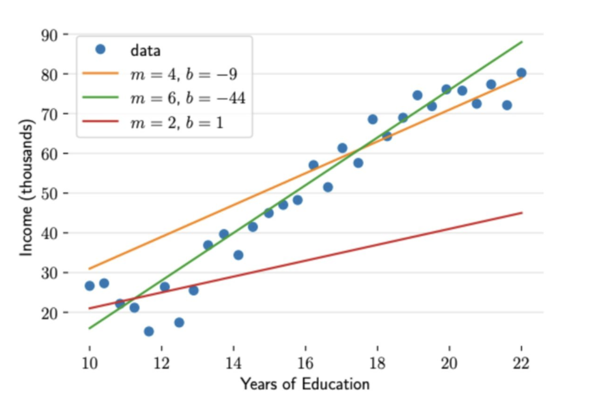

如上图是一个简单的示意图。当然拟合的曲线不一定非得是直线，后面我们会介绍这种情况。我们先使用此图来介绍它最简单的形态。

在上图中我们可以看到绿色的直线拟合得最好，但这是我们通过“瞪眼法”得到的结果。现在我们要用数学的方法来描述什么样的直线是好的、什么样的是不好的。这时候就要引出一个机器学习里关键的东西：损失函数（loss）。我们在小学二年级就学过直线的函数，可以用 `y=ax+b` 来表示一条直线；而在这里为了后面统一，我们使用 $\hat{y}=wx+b$ 来表示这条直线。蓝色的点用 $y$ 表示原始数据，$\hat{y}$ 表示通过这条直线预测的数值。然后我们就可以定义一个简单的损失函数，来描述直线到数据点的误差是多少，这个数越小代表越拟合。

【这里我们用小写表示单个数据，用大写表示数据矩阵或集合。比如 $\mathbf{x}=[x_1,x_2,x_3,\dots]^T$ 表示一个样本，$\mathbf{X}$ 表示由很多样本拼成的数据矩阵。】

$$
Loss(w,b) = \frac{1}{2n} \sum_{i=1}^{n} \left( y^{(i)} - \hat{y}^{(i)} \right)^2
$$

这里我们假设有 $n$ 个数据，把对应的 $X$ 坐标输入，就能得到这条线的损失值是多少。其中 $\hat{y}$ 是通过直线预测的数值，$y$ 是原始数据的值。现在我们有了损失函数，接下来只需求解它的最小值，就能得到我们想要的那条直线。求解最小值的方法有很多，比如这种简单的函数我们甚至可以直接求解；但一般情况下没办法这样做，我们会使用最小二乘法（对于更复杂的情况则使用梯度下降来求解）。

最小二乘法可以用来解决多维输入的情况。比如我们要预测房子的价格时，输入就是多维的，比如【房间面积、楼层、到市中心的距离、到车站的距离】共同决定价格，这时我们的预测函数应该是这样的：

$$
\hat{y}_i = w_1 x_{i1} + w_2 x_{i2} + \cdots + w_d x_{id} + b
$$

对于这样的形式，我们可以使用矩阵乘法的规则把它写成矩阵形式。为了方便，把 $b$ 也塞进权重向量里：给每个样本补一个恒为 1 的特征，即 $\mathbf{x}_i=[x_{i1},\dots,x_{id},1]^T$，$\mathbf{w}=[w_1,\dots,w_d,b]^T$，于是：

$$
\hat{\mathbf{y}} = \mathbf{X}\mathbf{w}
$$

对于上面的损失函数，我们也可以写成矩阵形式：

$$
Loss(\mathbf{w}) = \frac{1}{2n}\|\mathbf{X}\mathbf{w} - \mathbf{y}\|_2^2
$$

常数因子不影响最优解的位置，为了书写方便，我们可以去掉前面的 $\frac{1}{2n}$：

$$
\min_{\mathbf{w}} \|\mathbf{X}\mathbf{w} - \mathbf{y}\|_2^2
$$

接下来我们要对矩阵进行分解然后求解，最常用的两种方法就是 QR 分解和 SVD 分解：

**方法一：QR 分解**

将 $\mathbf{X}$ 分解为：

$$
\mathbf{X} = \mathbf{Q}\mathbf{R}
$$

其中 $\mathbf{Q}$ 的列向量两两正交且长度为 1（标准正交），$\mathbf{R}$ 是上三角矩阵。然后解：

$$
\mathbf{R}\mathbf{w} = \mathbf{Q}^T\mathbf{y}
$$

**方法二：SVD 分解**

$$
\mathbf{X} = \mathbf{U}\boldsymbol{\Sigma}\mathbf{V}^T
$$

最小二乘解：

$$
\hat{\mathbf{w}} = \mathbf{V}\boldsymbol{\Sigma}^+\mathbf{U}^T\mathbf{y}
$$

具体的求解过程在本文档不做具体介绍，因为现在我们有很多计算机工具可以用来自动求解（**scikit-learn**）。

### 逻辑回归

逻辑回归要解决的是分类问题，这里我们只介绍简单的二分类问题。

在开始之前我们要知道函数的本质就是一个集合到另一个集合的映射。比如 $y=x$ 在函数图像上是一条 45 度的斜线，它也可以说是把 X 原封不动地映射到 Y 上面，即输入 $x=114514$ 就输出 $y=114514$，不管输入 x 是多少，输出 y 的数值始终和 x 一样。逻辑回归的思想就是先把数据映射到一个数轴上，再把它们映射到 0 到 1 之间的数，即概率 $P$。

我们假设输入还是多维的，比如要判断一个人是不是大胃袋，就需要输入【身高、体重、饭量、运动量】等参数，然后使用同线性回归的方法把它们先映射到 z 轴上：

$$
z = \mathbf{w}^T \mathbf{x} + b = w_1x_1 + w_2x_2 + \cdots + w_nx_n + b
$$

然后我们再通过 `Sigmoid` 函数把 z 映射到概率（0 到 1 之间的数）：

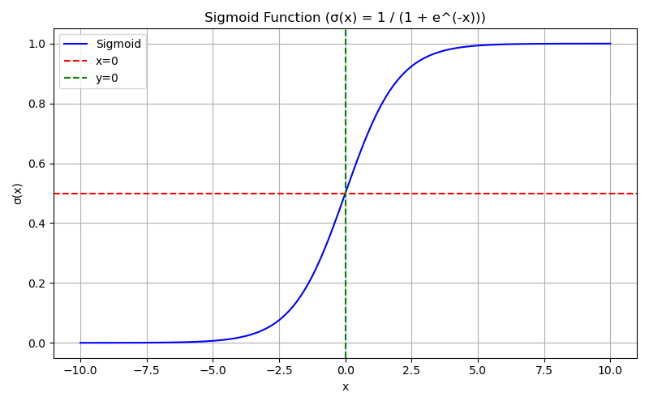

$$
\sigma(z)=\frac{1}{1+e^{-z}}
$$

比如我们规定是大胃袋为 1、不是为 0，则会有：

$$
P(y=1|x)=\sigma(\mathbf{w}^T \mathbf{x}+b)\\
P(y=0|x)=1-P(y=1|x)
$$

这里我们使用交叉熵损失（负对数似然）来作为损失函数 $Loss$：

$$
Loss(\mathbf{w},b)=-\sum_{i=1}^{n}\left[y_i\log \hat{y}_i + (1-y_i)\log(1-\hat{y}_i)\right]
$$

其中 $\hat{y}_i = P(y_i=1|x_i)$。

这个损失函数是由极大似然估计推导出来的。似然函数是：

$$
L(\mathbf{w},b)=\prod_{i=1}^{n} p_i^{y_i}(1-p_i)^{1-y_i}
$$

其中 $p_i=\hat{y}_i$。取负对数就得到上面的交叉熵损失（再除以 $n$ 就是平均交叉熵）。

这里依然是求解它的最小值，使用的方法就是后面我们最常用的梯度下降，在这里我们不过多介绍，在后面的深度神经网络部分会详细介绍梯度下降相关的算法。

### KNN

KNN 算法可以说是很简单的一个算法了，它的核心思想就是比较。

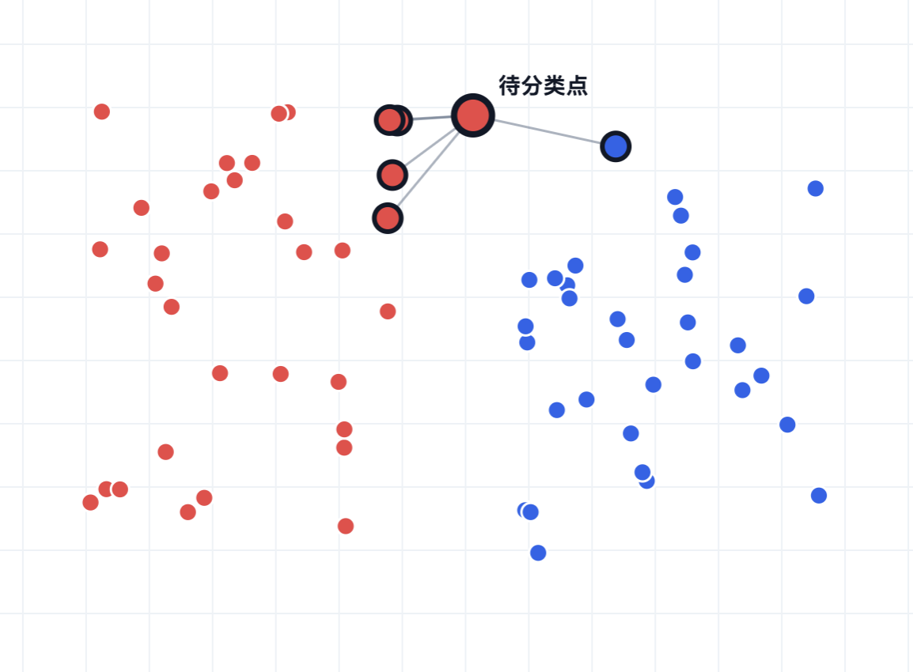

如图所示，红色和蓝色的点是已知数据，待分类点是输入数据。这里我们取离它最近的 5 个点，比较其中红色和蓝色的数量，最终确定待分类点为红色（红 4 蓝 1，则有 80% 为红色、20% 为蓝色）。

在 KNN 算法里我们要第一次引入超参数的概念。KNN 中的超参数就是 k，即取最近点的个数，如上图例子中的 k=5。之后我们还会见到很多超参数（超参），比如学习率、批量大小、迭代次数……这些都是超参数。超参数比较书面的描述如下：**超参数是模型训练前需要人为设定的参数，不能直接从训练数据中学习，通常通过验证集或交叉验证来选择。**

### 决策树

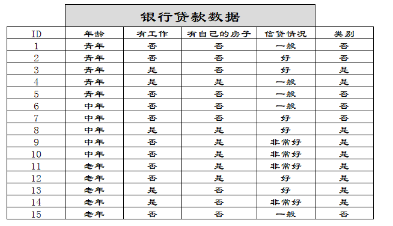

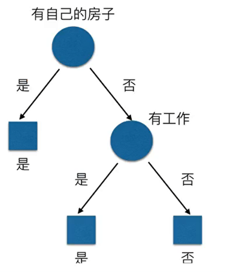

我们先看上面的两张图片。其实决策树本质就是一棵树，数据从树根开始流过这棵树。比如上面两图其实就是在判断要不要批准这 15 个人的贷款：我们让数据从这棵树的头顶往下流，先判断这个人有没有房子，有就批准贷款；没有就进一步判断有没有工作，有就批准贷款，没有就不批准。

那么问题就来了，对于决策树来说我们应该怎么决定这个分类的先后顺序呢，即为什么要把“有没有自己的房子”的判断放在第一位？这时候就要引出两个概念：信息熵和信息增益：

$$
H(D) = -\sum_{k=1}^{K} \frac{|C_k|}{|D|} \log_2 \frac{|C_k|}{|D|}
$$

$$
g(D,A)=H(D)-H(D|A)
$$

我们实际上是通过比较信息增益的大小来决定什么条件在前、什么条件在后。如上图，我们让 $A_1,A_2,A_3,A_4$ 分别代表年龄、有没有工作、有没有自己的房子、信贷情况这四个特征。先算数据集本身的信息熵：

$$
H(D)=-\frac{9}{15}\log_2\frac{9}{15}-\frac{6}{15}\log_2\frac{6}{15}=0.971
$$

然后就有（保留三位小数）：

$$
g(D, A_1) = H(D) - \left[ \frac{5}{15}H(D_1) + \frac{5}{15}H(D_2) + \frac{5}{15}H(D_3) \right] = 0.083
$$

$$
H(D_1) = -\frac{2}{5}\log_2\frac{2}{5} - \frac{3}{5}\log_2\frac{3}{5} = 0.971
$$

$$
H(D_2) = -\frac{3}{5}\log_2\frac{3}{5} - \frac{2}{5}\log_2\frac{2}{5} = 0.971
$$

$$
H(D_3) = -\frac{4}{5}\log_2\frac{4}{5} - \frac{1}{5}\log_2\frac{1}{5} = 0.722
$$

同理可得 $g(D,A_2)=0.324$，$g(D,A_3)=0.420$，$g(D,A_4)=0.363$。其中 $g(D,A_3)$ 的数值最大，所以我们应该把 $A_3$ 代表的“有没有自己的房子”排在第一。

### 朴素贝叶斯

朴素贝叶斯听着很难，但其实也没什么，它就是在贝叶斯公式的基础上推导出来的一个分类算法：

$$
P(Y|X) = \frac{P(X|Y)P(Y)}{P(X)}
$$

上面这个公式就是我们见到的最多的贝叶斯公式。但当我们的输入特征很多的时候，我们就没办法直接使用上面的公式来计算了。我们假设决定一个事件 $Y$ 是否为真的因素有 $[x_1,x_2,x_3,\dots,x_n]$，并且假设这些特征都是相互独立的，我们就有了以下公式：

$$
P(X|Y) = P(x_1, x_2, \dots, x_n|Y) = \prod_{i=1}^{n} P(x_i|Y)
$$

有了这两个公式我们就可以开始举例说明了：我们假设有 10 个西瓜，它们每个都有瓜蒂、形状、颜色这三个特征以及对应的成熟情况。这个表格内的西瓜就是我们的训练数据，而我们要预测的是瓜蒂脱落、圆形、青色的西瓜成熟的概率是多少：

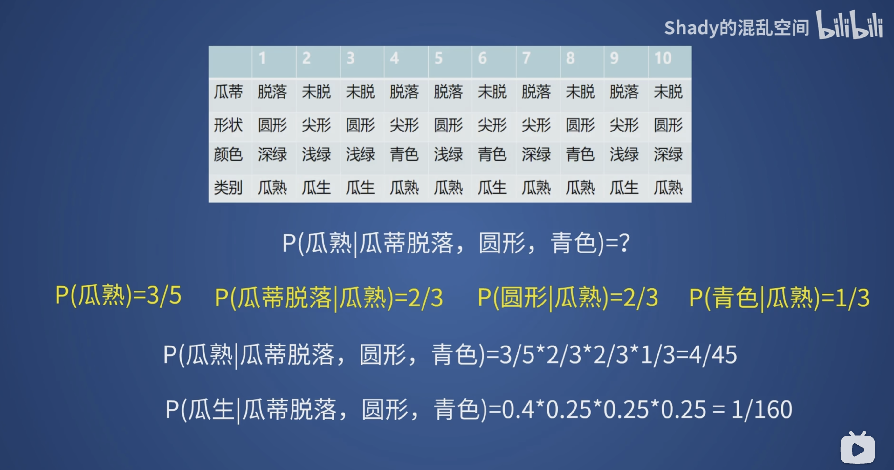

在训练阶段，我们先使用贝叶斯公式把成熟西瓜对应的各个特征概率计算出来，也就是图中黄色的部分；然后在预测部分，我们直接把数值带入计算，就能得到这个西瓜“成熟”和“是生瓜蛋子”的概率分别是多少。通过比较概率的大小，我们就能知道这个西瓜是成熟的概率更大。

朴素贝叶斯的训练就是在计算各个先验概率，预测部分就是通过训练得到的先验概率来计算后验概率。它的训练速度很快，但是由于它强行把特征条件都假设成独立的，而在现实中这些条件并不独立，所以朴素贝叶斯的准确性不能得到保证。

### 机器学习小结

这一章到这里就差不多了。你可能会觉得这几个算法东一榔头西一棒子，其实它们都在干同一件事：**从数据里找一个从输入到输出的映射**，只是这个映射的形式不一样。

先把它们放在一起对比一下：

| 算法 | 任务 | 模型长什么样 | 损失/准则 | 一句话总结 |
|:---|:---|:---|:---|:---|
| 线性回归 | 回归 | 一条直线/超平面 | 均方误差 | 用一条线去拟合数据的走向 |
| 逻辑回归 | 二分类 | 线性模型 + Sigmoid | 交叉熵 | 把线性输出压成概率 |
| KNN | 分类/回归 | 不训练，存数据 | 无训练损失（距离度量） | 看离得最近的 k 个邻居是谁 |
| 决策树 | 分类/回归 | if-then 规则树 | 信息增益/基尼指数 | 用一系列判断把数据切开 |
| 朴素贝叶斯 | 分类 | 贝叶斯公式 + 独立假设 | 负对数似然 | 用先验概率算后验概率 |

它们共同的套路其实就四步：

1. **选模型**：决定用什么样的函数去拟合数据，也就是确定“假设空间”。
2. **定损失**：定义什么叫“好”、什么叫“不好”，比如均方误差、交叉熵。
3. **做优化**：想办法让损失最小，比如最小二乘法、梯度下降。
4. **选超参数**：用验证集或交叉验证挑 k、树的深度、学习率这些不能直接从数据里学的东西。

这一章还反复出现了几个概念，后面会一直用到：

- **监督学习 vs 无监督学习 vs 强化学习**：监督学习有标签，无监督学习没有标签，强化学习只有 reward，而且数据是自己一步一步试出来的。
- **分类 vs 回归**：输出是离散的类别还是连续的数值。
- **参数 vs 超参数**：参数是模型自己学出来的（比如权重 $w$），超参数是人调的（比如 k、学习率）。
- **过拟合 vs 欠拟合**：模型把训练数据背下来了，还是根本没学会。
- **训练集 / 验证集 / 测试集**：训练用训练集，调参用验证集，最后只在测试集上评估一次。
- **特征工程和归一化**：线性模型和 KNN 对特征的尺度很敏感，做之前最好先把数据标准化。

还有一个很重要的心态：**没有哪个算法是万能的**。线性模型简单、可解释，但拟合不了复杂的非线性关系；决策树可解释、能处理非线性，但容易过拟合；KNN 几乎不训练，但预测慢、怕高维；朴素贝叶斯训练快，但特征独立假设往往不成立。选算法要看你的数据长什么样、任务要求是什么，而不是看哪个名字听起来更高级。

这些“老式”机器学习算法现在很少单独拿来解决复杂问题，但它们绝对不是白学的：

- 一个神经元本质上就是一个线性回归或逻辑回归；
- 一层神经网络就是很多个这样的模型并排放在一起；
- 损失函数、梯度下降、过拟合、训练集/验证集这些概念，在深度学习和强化学习里会原封不动地再出现一遍。

所以如果你只想记住一句话，那就是：**机器学习 = 模型 + 损失 + 优化**。下一章的深度神经网络，无非是把这里的“模型”换成了多层非线性函数，把“优化”换成了反向传播而已。

## 深度神经网络

在上面我们介绍了一些最常见的机器学习算法。这些机器学习算法和深度神经网络的关系有点像砖块和墙的关系：在深度神经网络中，每个节点就是一个线性回归、逻辑回归或者其他算法，我们使用这些“砖块”来织成一张网，这张网就是深度神经网络【model，模型】。

在本章我会介绍两个深度神经网络：MLP 和 CNN，以及求解它们的一些算法。MLP 可以说是几乎所有深度神经网络的基石：CNN 最后的分类头通常是全连接层，Transformer 的每个 block 里也都有一个前馈网络（FFN），它们本质上都是 MLP。

现在开始我们就要介绍我们在强化学习中使用到的一个最常用的深度神经网络——**MLP** 网络【多层感知机】。

### 感知机&MLP网络

#### 从感知机说起

我们现在说的神经网络，最早可以追溯到 1958 年 Rosenblatt 提出的感知机（Perceptron）。它的结构简单到有点寒酸：输入一堆数，每个数乘一个权重，加起来，再加一个偏置，最后过一个阶跃函数：

$$
z = \mathbf{w}^T\mathbf{x}+b,\qquad
\hat{y}=
\begin{cases}
1, & z\ge 0\\
0, & z<0
\end{cases}
$$

你可以把它看成一个只会回答“是”或“不是”的线性分类器。它在二维平面上就是在画一条直线，直线一边是一类，另一边是另一类。

感知机当时被吹得很神，直到 1969 年 Minsky 和 Papert 写了本《Perceptrons》，指出单层感知机连 XOR（异或）都学不会。XOR 的输入输出是这样的：

| $x_1$ | $x_2$ | $y$ |
|:---:|:---:|:---:|
| 0 | 0 | 0 |
| 0 | 1 | 1 |
| 1 | 0 | 1 |
| 1 | 1 | 0 |

你没法用一条直线把 $(0,0)$、$(1,1)$ 和 $(0,1)$、$(1,0)$ 分开，所以单层感知机在这里直接罢工。

那怎么办？加一层。用两个隐藏神经元先画两条线：

$$
h_1 = \begin{cases}1, & x_1+x_2\ge 0.5\\0, & \text{otherwise}\end{cases}
\qquad
h_2 = \begin{cases}1, & x_1+x_2\ge 1.5\\0, & \text{otherwise}\end{cases}
$$

然后输出 $y=h_1-h_2$，就得到了 XOR：

| $x_1$ | $x_2$ | $h_1$ | $h_2$ | $y$ |
|:---:|:---:|:---:|:---:|:---:|
| 0 | 0 | 0 | 0 | 0 |
| 0 | 1 | 1 | 0 | 1 |
| 1 | 0 | 1 | 0 | 1 |
| 1 | 1 | 1 | 1 | 0 |

这里的权重是我们手算出来的，不是学出来的，但它说明了一件事：**一层线性分类器解决不了的问题，多叠一层就有机会解决**。这就是“多层”感知机的意义。

#### MLP 的结构

MLP（Multi-Layer Perceptron，多层感知机）就是由输入层、若干隐藏层和输出层堆起来的全连接网络：

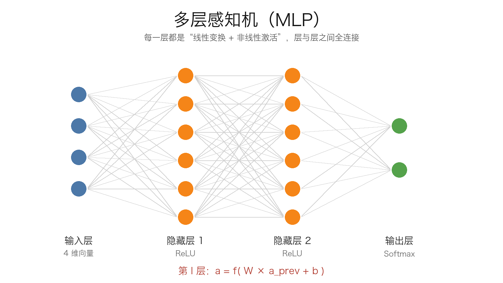

- **输入层**：不算“层”，它只是把原始数据 $\mathbf{x}$ 接进来。
- **隐藏层**：真正的计算层，每一层都做“线性变换 + 激活函数”。
- **输出层**：把最后一层的特征变成我们想要的预测值。

“隐藏”这个词没有太多玄机，只是因为这些层既不是输入也不是输出，从外面看不见而已。

我们用上标 $[l]$ 表示第 $l$ 层，用 $n_l$ 表示这一层的神经元个数。设 $\mathbf{a}^{[0]}=\mathbf{x}$，那么第 $l$ 层的前向计算就是：

$$
\mathbf{z}^{[l]} = \mathbf{W}^{[l]}\mathbf{a}^{[l-1]}+\mathbf{b}^{[l]}
$$

$$
\mathbf{a}^{[l]} = f_l\left(\mathbf{z}^{[l]}\right)
$$

其中 $\mathbf{W}^{[l]}\in\mathbb{R}^{n_l\times n_{l-1}}$，$\mathbf{b}^{[l]}\in\mathbb{R}^{n_l}$，$f_l$ 是这一层的激活函数。最后一层的输出 $\mathbf{a}^{[L]}$ 就是模型的预测值 $\hat{\mathbf{y}}$。

一层有多少参数？权重 $n_l\times n_{l-1}$ 个，偏置 $n_l$ 个，一共：

$$
n_l n_{l-1}+n_l
$$

比如一个 4-16-16-2 的 MLP：

- 第一层：$4\times 16+16=80$
- 第二层：$16\times 16+16=272$
- 第三层：$16\times 2+2=34$

总共 386 个参数。是不是比想象中少？这也是 MLP 在小规模任务上很好用的原因。

那为什么非要“深”呢？一个隐藏层只要神经元足够多，理论上也能拟合很多函数——这就是**万能近似定理**（Universal Approximation Theorem）：一个包含足够多神经元的单隐藏层网络，可以以任意精度逼近有界闭集上的连续函数。但注意，**能表示不等于能训练，能训练也不等于能泛化**。深层网络的好处是它可以一层一层地组合特征：浅层学边缘、纹理，中层学部件，深层学物体；同样的表达能力，深网络往往比宽网络需要更少的参数。

#### 前向传播

前向传播（forward propagation）就是输入从第一层流到最后一层，算出预测值。上面那个公式重复 $L$ 次，就是整个前向传播：

$$
\mathbf{a}^{[0]}=\mathbf{x}
\;\longrightarrow\;
\mathbf{z}^{[1]}=\mathbf{W}^{[1]}\mathbf{a}^{[0]}+\mathbf{b}^{[1]}
\;\longrightarrow\;
\mathbf{a}^{[1]}=f_1(\mathbf{z}^{[1]})
\;\longrightarrow\;
\cdots
\;\longrightarrow\;
\hat{\mathbf{y}}=\mathbf{a}^{[L]}
$$

实际写代码时，我们一般一次喂一个 batch 的数据。设一个 batch 有 $m$ 个样本，把输入排成矩阵 $\mathbf{A}^{[0]}\in\mathbb{R}^{m\times n_0}$，那么：

$$
\mathbf{Z}^{[l]} = \mathbf{A}^{[l-1]}\left(\mathbf{W}^{[l]}\right)^T+\mathbf{b}^{[l]}
$$

$$
\mathbf{A}^{[l]} = f_l\left(\mathbf{Z}^{[l]}\right)
$$

这里的 $+\mathbf{b}^{[l]}$ 会广播到每一行。矩阵形式的好处是 GPU 可以并行算，不然一个一个样本循环，训练得等到天荒地老。

#### 输出层长什么样

输出层用什么激活函数，取决于你的任务：

- **回归**：输出一个实数，比如预测房价、预测关节力矩。输出层不加激活函数，直接输出线性结果。
- **二分类**：输出一个概率，用 Sigmoid，只有一个输出节点。
- **多分类**：输出每个类别的概率，用 Softmax，节点数等于类别数。

这个选择要和损失函数配套，下一节会讲。

### 激活函数

#### 为什么需要激活函数

如果没有激活函数，MLP 会退化成线性回归。我们把两层叠起来看看：

$$
\mathbf{z}^{[2]}=\mathbf{W}^{[2]}\mathbf{a}^{[1]}+\mathbf{b}^{[2]}
=\mathbf{W}^{[2]}\left(\mathbf{W}^{[1]}\mathbf{x}+\mathbf{b}^{[1]}\right)+\mathbf{b}^{[2]}
=\left(\mathbf{W}^{[2]}\mathbf{W}^{[1]}\right)\mathbf{x}+\left(\mathbf{W}^{[2]}\mathbf{b}^{[1]}+\mathbf{b}^{[2]}\right)
$$

你看，两层线性变换乘起来还是一个线性变换。堆 100 层和堆 1 层没有本质区别，只是参数更多、算得更慢、显存更贵。所以激活函数的作用不是“让网络更非线性一点”这么模糊，而是**给网络提供表达非线性函数的能力**。

#### 常见激活函数

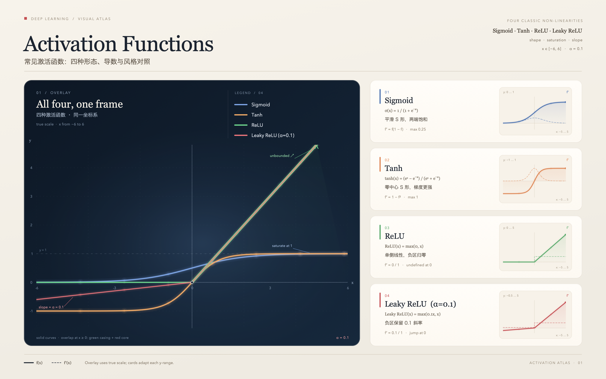

| 名称 | 公式 | 输出范围 | 导数 | 常见用途 |
|:---|:---|:---:|:---|:---|
| Sigmoid | $\sigma(z)=\dfrac{1}{1+e^{-z}}$ | $(0,1)$ | $\sigma(z)(1-\sigma(z))$ | 二分类输出层、门控 |
| Tanh | $\tanh(z)=\dfrac{e^z-e^{-z}}{e^z+e^{-z}}$ | $(-1,1)$ | $1-\tanh^2(z)$ | 早期隐藏层、RNN |
| ReLU | $\max(0,z)$ | $[0,+\infty)$ | $1$（$z>0$），$0$（$z<0$） | 隐藏层默认选择 |
| Leaky ReLU | $\max(\alpha z,z)$ | $(-\infty,+\infty)$ | $1$（$z>0$），$\alpha$（$z<0$） | 防止神经元死亡 |
| GELU | $z\Phi(z)$ | 约 $(-0.17,+\infty)$ | 见框架实现 | Transformer、大模型 |

**Sigmoid**：把任意实数压到 $(0,1)$，看起来很像个概率。但它的两头非常平，导数最大只有 0.25，深层网络里连乘几次就趋近于 0，这就是经典的**梯度消失**。所以现在基本只在二分类输出层见到它，隐藏层很少用了。

**Tanh**：和 Sigmoid 形状差不多，但输出是零中心的，收敛通常比 Sigmoid 好一点。缺点是一样的：两端饱和，梯度还是会消失。

**ReLU**：小于 0 直接躺平，大于 0 原样通过。计算快，正区间梯度恒为 1，是目前隐藏层最常用的默认选择。它的缺点是负区间梯度为 0，如果学习率太大，某些神经元可能再也收不到梯度，变成“死亡神经元”。

**Leaky ReLU**：给负区间留一个小斜率 $\alpha$（通常 0.01），让死掉的神经元还有机会被救回来。

**GELU**：比 ReLU 更平滑，在 0 附近不是硬拐弯，Transformer 系列模型很喜欢用。它的完整形式是 $z\Phi(z)$，其中 $\Phi$ 是标准正态分布的累积分布函数；实际实现常用 tanh 近似，没必要手算。

怎么选？给你一个不太严谨但很好用的建议：

- 隐藏层先无脑 ReLU，跑不起来再试 Leaky ReLU 或 GELU。
- 二分类输出层用 Sigmoid。
- 多分类输出层用 Softmax。
- 回归输出层不加激活。
- 不要用 Sigmoid 堆深层网络，除非你是在复现 2010 年以前的论文。

### 损失函数

损失函数回答一个问题：**模型现在错得有多离谱？** 训练的目标就是让这个数越小越好。

#### 回归：均方误差

$$
Loss=\frac{1}{n}\sum_{i=1}^{n}\left(\hat{y}_i-y_i\right)^2
$$

平方有两个作用：一是把正负误差都变成正数，二是放大离谱的预测。比如误差 1 和误差 10，平方之后是 1 和 100，模型会更在意那个错得离谱的样本。副作用是它对离群点很敏感，一个异常值就能把整条拟合线拉歪。如果数据里离群点多，可以考虑 MAE 或 Huber 损失。

（前面线性回归用了 $\frac{1}{2n}$，这里用 $\frac{1}{n}$，只差一个常数，不影响最优解。）

#### 二分类：二元交叉熵

$$
Loss=-\frac{1}{n}\sum_{i=1}^{n}\left[y_i\log \hat{y}_i+(1-y_i)\log(1-\hat{y}_i)\right]
$$

其中 $y_i\in\{0,1\}$，$\hat{y}_i$ 是 Sigmoid 输出的概率。它到底在干什么？看几个数就明白了：

| 真实标签 $y$ | 预测概率 $\hat{y}$ | 损失 $-\log\hat{y}$ |
|:---:|:---:|:---:|
| 1 | 0.99 | 0.010 |
| 1 | 0.50 | 0.693 |
| 1 | 0.01 | 4.605 |
| 0 | 0.01 | 0.010 |

预测得越自信而且越错，损失就越大，梯度也会越大。这就是交叉熵比 MSE 更适合分类的原因：MSE 在 Sigmoid 饱和区梯度太小，学不动；交叉熵配 Sigmoid 的梯度形式很干净。

实际实现时要注意 $\log(0)$ 会炸，框架一般会在内部加一个极小值，或者直接提供 `BCEWithLogitsLoss` 这种把 Sigmoid 和交叉熵合在一起、数值更稳定的版本。

#### 多分类：Softmax + 交叉熵

多分类时，网络最后一层输出 $K$ 个分数 $z_1,\dots,z_K$，先过 Softmax 变成概率：

$$
\hat{y}_k=\frac{e^{z_k}}{\sum_{j=1}^{K}e^{z_j}},\qquad k=1,\dots,K
$$

然后和 one-hot 标签算交叉熵：

$$
Loss=-\sum_{k=1}^{K}y_k\log \hat{y}_k
$$

Softmax 不改变分数的大小顺序，只是把分数变成一组和为 1 的概率。比如三个类别的分数是 $[2.0,1.0,0.1]$，Softmax 之后大约是 $[0.659,0.242,0.099]$，模型就会认为第一个类别最可能。

数值实现上，直接算 $e^{z_k}$ 可能会溢出。标准做法是先减去最大值：

$$
\hat{y}_k=\frac{e^{z_k-\max_j z_j}}{\sum_{j=1}^{K}e^{z_j-\max_j z_j}}
$$

分子分母同乘一个常数，结果不变，但数值上安全多了。PyTorch 的 `CrossEntropyLoss` 已经把 Softmax 和负对数似然合在一起了，输入应该是 logits，不要再手动 Softmax 一次，不然相当于做了两遍。

最后提醒一句：**损失函数只负责训练，不负责评价**。分类任务还要看准确率、F1，回归任务还要看 MAE、RMSE，机器人任务还要看成功率、能耗、摔倒次数。损失低不代表任务完成得好。

### 梯度下降与反向传播

#### 梯度下降

想象你蒙着眼站在山上，想走到谷底。你只能用脚感受哪个方向最陡，然后往那个方向迈一小步。梯度就是“最陡的上坡方向”，所以我们要往负梯度方向走：

$$
\mathbf{w}_{t+1}=\mathbf{w}_t-\eta\frac{\partial Loss}{\partial \mathbf{w}_t}
$$

其中 $\eta$ 是学习率，也就是步长。步长太大，你可能一步跨过谷底，甚至在两边来回振荡；步长太小，你走到天荒地老也到不了。训练神经网络的大部分玄学，都和这个 $\eta$ 有关。

根据每次更新用多少数据，梯度下降有三种常见形式：

- **批量梯度下降（Batch GD）**：每次用全部训练数据算梯度。方向准，但慢，而且数据量大时显存放不下。
- **随机梯度下降（SGD）**：每次只用一个样本。更新快，但噪声大，损失曲线会抖。
- **小批量梯度下降（Mini-batch GD）**：每次用一小批，比如 32、64、128、256 个样本。这是实际最常用的方式，兼顾速度和稳定性。

几个容易混的概念：

- **batch size**：一次前向/反向传播用多少个样本。
- **iteration / step**：一次参数更新。
- **epoch**：把整个训练集完整过一遍。

比如训练集有 10000 个样本，batch size 是 64，那么一个 epoch 需要 $\lceil 10000/64\rceil=157$ 次迭代。

学习率也不是一成不变的。常见做法有 warmup（先小后大）、step decay（每隔一段时间乘 0.1）、cosine decay（余弦下降到 0）等。经验上：

- SGD + momentum：学习率从 0.01 或 0.1 开始调。
- Adam：默认 $\eta=10^{-3}$ 是很好的起点。

损失函数大多数时候不是凸的，所以会有局部极小值、鞍点、平坦区域。高维空间里鞍点比局部极小值更常见，而小批量带来的噪声反而有助于逃离这些糟糕的区域。这也是为什么我们很少真的用“全量数据算梯度”的方式训练深度网络。

#### 反向传播

反向传播（backpropagation）经常被说得很神秘，但它不是一种优化算法，它只是**高效计算梯度的方法**；真正更新参数的是梯度下降或者它的变种。

它的本质就是链式法则 + 动态规划：前向传播时把中间结果存下来，反向传播时从损失开始，一层一层往回乘导数。我们拿一个两层网络举个例子：

$$
\mathbf{z}_1=\mathbf{W}_1\mathbf{x}+\mathbf{b}_1,\quad
\mathbf{a}_1=f(\mathbf{z}_1),\quad
\mathbf{z}_2=\mathbf{W}_2\mathbf{a}_1+\mathbf{b}_2,\quad
\hat{\mathbf{y}}=\mathrm{softmax}(\mathbf{z}_2)
$$

损失用交叉熵。对 Softmax + 交叉熵，输出层的误差有一个非常漂亮的形式：

$$
\boldsymbol{\delta}_2=\frac{\partial Loss}{\partial \mathbf{z}_2}=\hat{\mathbf{y}}-\mathbf{y}
$$

然后：

$$
\frac{\partial Loss}{\partial \mathbf{W}_2}=\boldsymbol{\delta}_2\mathbf{a}_1^T,\qquad
\frac{\partial Loss}{\partial \mathbf{b}_2}=\boldsymbol{\delta}_2
$$

误差继续往回传：

$$
\boldsymbol{\delta}_1=\left(\mathbf{W}_2^T\boldsymbol{\delta}_2\right)\odot f'(\mathbf{z}_1)
$$

$$
\frac{\partial Loss}{\partial \mathbf{W}_1}=\boldsymbol{\delta}_1\mathbf{x}^T,\qquad
\frac{\partial Loss}{\partial \mathbf{b}_1}=\boldsymbol{\delta}_1
$$

其中 $\odot$ 是逐元素相乘。你看，规律很清楚：**本层的误差 = 后一层误差乘权重，再乘本层激活函数的导数**。框架里的自动微分（autograd）只是把这个过程自动化了，并且能处理任意复杂的计算图。你手推过一遍之后，再看 PyTorch 的 `loss.backward()` 就不会觉得它是在变魔术了。

深层网络的一个老问题是**梯度消失/爆炸**。反向传播是连乘，如果每一层的导数都小于 1，乘几十次就变成 0；如果都大于 1，就会指数级爆炸。Sigmoid 的导数最大只有 0.25，所以深层 Sigmoid 网络特别容易梯度消失。缓解办法包括：用 ReLU、合理的权重初始化（Xavier/He）、批归一化/层归一化、残差连接，以及梯度裁剪（RNN/RL 里很常用）。

如果你自己写了自定义层，可以用数值梯度做梯度检查：给某个参数加一个很小的 $\epsilon$，算 $(Loss(w+\epsilon)-Loss(w-\epsilon))/(2\epsilon)$，和解析梯度对比。两者差太多，说明反向传播写错了。

#### 优化器

梯度下降只告诉你“往哪走”，优化器决定“怎么走得更聪明”。常见的有：

- **SGD**：最朴素，配合 momentum 后很好用。
- **Momentum**：把历史梯度累积起来，像小球下山有惯性，能冲过小坑和鞍点。
- **RMSProp**：给每个参数自适应学习率，适合非平稳目标。
- **Adam**：动量 + 自适应学习率，收敛快，默认参数通常就能用。
- **AdamW**：把 weight decay 和自适应学习率解耦，现在很多模型默认用它。

初学者最容易犯的错是“损失不降就换优化器”。大多数时候问题不在优化器，而在数据、标签、学习率、网络结构或者损失函数和输出层不匹配。先把这些检查一遍，再考虑换优化器。

#### 训练流程和 sanity check

一个标准的训练循环大概是这样的：

1. 打乱训练数据，按 batch 取数据。
2. 前向传播，算损失。
3. 反向传播，算梯度。
4. 优化器更新参数。
5. 清空梯度，进入下一个 batch。
6. 每个 epoch 结束后在验证集上评估，保存最好的模型。

在正式训练之前，建议先做一个 sanity check：拿一个很小的 batch（比如 8 个样本），让模型反复训练，看能不能把损失压到接近 0。如果连这个小 batch 都过拟合不了，说明代码大概率有问题，别急着上全量数据。

如果损失完全不降，按这个顺序检查：

- 标签有没有搞反、类别有没有对错。
- 学习率是不是太大或太小。
- 输入有没有归一化，有没有 NaN。
- 损失函数和输出层是否匹配（回归配 MSE，二分类配 Sigmoid + BCE，多分类配 Softmax + CE）。
- 梯度是不是全 0 或者 NaN。
- 数据加载器有没有把数据和标签弄混。

### 过拟合与正则化

训练集上的损失一直降，验证集上的损失先降后升，这是典型的**过拟合**：模型把训练数据背下来了，但没有学到能泛化的规律。

和它相对的是**欠拟合**：模型太简单，连训练集都拟合不好。欠拟合的解决办法是加参数、加层、训练更久；过拟合的解决办法是加数据、加约束、早点停。

一般把数据分成三份：

- **训练集**：用来更新参数。
- **验证集**：用来调超参数、选模型、早停。
- **测试集**：最后只用一次，估计真实泛化能力。不要拿测试集调参，不然你就是在变相过拟合测试集。

常见的正则化手段：

- **更多数据**：最有效，但很多时候没有。
- **数据增强**：图像翻转、裁剪、颜色抖动；机器人任务里就是随机化地形、质量、摩擦、推力，也就是后面 Isaac Lab 会讲的 domain randomization。
- **L2 正则 / weight decay**：在损失里加 $\lambda\|\mathbf{w}\|_2^2$，让权重别太大。
- **Dropout**：训练时随机把一部分神经元置零，测试时关闭。它相当于每次训练一个子网络，最后做一个 ensemble。PyTorch 里记得用 `model.eval()` 切换到测试模式。
- **早停（early stopping）**：验证集连续若干个 epoch 不下降就停，保存验证集最好的 checkpoint。
- **减小模型**：层数、宽度、参数量降下来。
- **标签平滑（label smoothing）**：把 one-hot 标签从 1 变成 $1-\epsilon$，从 0 变成 $\epsilon/(K-1)$，避免模型过度自信。

批归一化（BatchNorm）和层归一化（LayerNorm）经常被放在正则化里讲，但它们的主要作用其实是稳定训练、加速收敛，不要完全指望它们防止过拟合。

在强化学习里，过拟合往往更隐蔽：策略可能记住了训练时的地形、初始状态和扰动，换一个场景就摔给你看。所以后面做 Isaac Lab 的时候，随机初始化和域随机化不是“可选项”，而是让策略能真正落地的重要手段。

### CNN

#### 为什么全连接网络处理图像不行

MLP 处理的是向量，但图像是一个二维甚至三维的张量（高 × 宽 × 通道）。如果你直接把图像拉平喂给 MLP，会碰到两个问题。

第一个是**参数爆炸**。一张 $224\times224\times3$ 的 RGB 图片有 150528 个输入。如果第一层隐藏层只有 1000 个神经元，光这一层就有 $150528\times1000\approx1.5\times10^8$ 个参数。一层就一亿五千万个参数，训练不动，显存也放不下。

第二个是**空间结构丢失**。把图像拉平之后，模型不知道哪些像素是相邻的，也不知道一个物体平移几个像素之后还是同一个物体。对 MLP 来说，输入向量的第 1 个元素和第 2 个元素之间没有“相邻”这个概念。

CNN 用两个先验来解决这两个问题：

- **局部连接**：每个神经元只看输入的一小块区域，而不是全图。
- **权重共享**：同一个卷积核在整张图上滑动，所有位置共用同一组权重。

这两个先验让 CNN 的参数量大幅减少，也更适合处理图像这种有空间结构的信号。

#### 卷积

卷积核（filter / kernel）就是一个小矩阵，比如 $3\times3$。把它盖在图像左上角，对应位置相乘再求和，得到一个数；然后往右滑一步，重复；滑完一行再往下走。滑完一整张图，就得到了一张新的特征图。

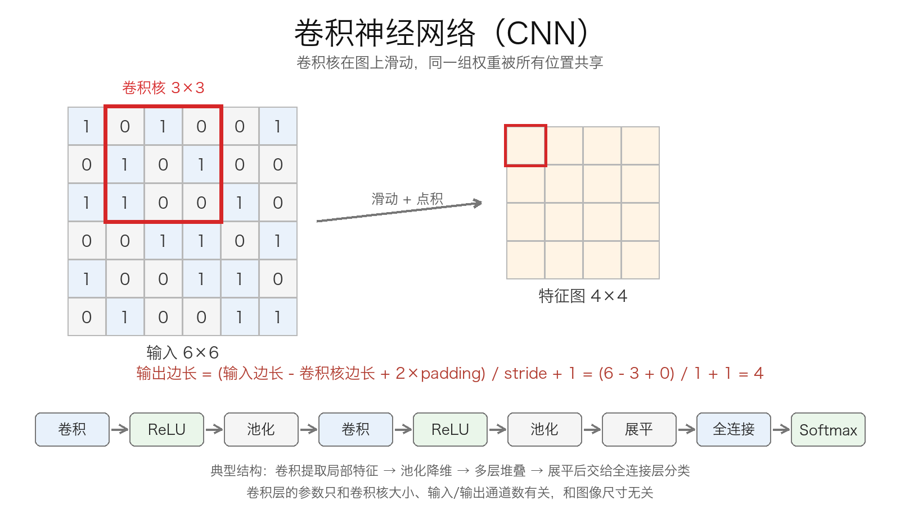

用公式写就是：

$$
y_{i,j}=\sum_{u=0}^{K-1}\sum_{v=0}^{K-1}w_{u,v}x_{i+u,j+v}+b
$$

其中 $K$ 是卷积核边长，$w_{u,v}$ 是核里的权重，$b$ 是偏置。

严格来说，深度学习里这个操作叫**互相关**（cross-correlation），并没有把卷积核翻转；真正的数学卷积会先翻转核。但因为在网络里核的权重是学出来的，翻不翻转不影响表达能力，所以大家也就都叫它卷积了。

卷积之后特征图的大小由三个东西决定：卷积核大小 $K$、步长 $S$（stride）、填充 $P$（padding）：

$$
H_{out}=\left\lfloor\frac{H_{in}+2P-K}{S}\right\rfloor+1
$$

- **padding**：在图像边缘补一圈 0。`padding=1` 配 $3\times3$ 卷积、stride=1 时可以保持尺寸不变，叫 `same`；不补就是 `valid`，每卷一次尺寸都会变小。
- **stride**：一次滑几步。`stride=1` 是逐像素滑，`stride=2` 一次走两格，输出尺寸大约减半。

如果输入有多个通道（比如 RGB 三通道），每个卷积核也要有同样的深度。一个 $3\times3\times3$ 的核在 RGB 图上滑动，每次覆盖 $3\times3\times3=27$ 个数，乘加之后得到一个输出。如果我们想要 8 个输出通道，就用 8 个这样的核，得到 $8$ 张特征图。

所以卷积层的参数量是：

$$
\left(K_h\times K_w\times C_{in}+1\right)\times C_{out}
$$

比如 $3\times3\times3$ 的核、8 个输出通道，参数量是 $(3\times3\times3+1)\times8=224$。对比一下前面 MLP 的一亿五千万，你就知道为什么 CNN 适合图像了。

**权重共享**还带来一个性质：平移等变性（translation equivariance）。图像里的物体往右移，特征图里的响应也会往右移。注意是“等变”不是“不变”，真正的平移不变性还要靠池化或者全局池化来近似。

**局部感受野**是另一个关键词。每个输出只看输入的一小块，但层数越深，感受野越大。三个 $3\times3$、stride=1 的卷积堆起来，感受野是 $7\times7$，但参数量比一个 $7\times7$ 卷积少得多（忽略偏置，假设输入输出都是单通道，$3\times9=27$ 对 $49$）。这就是“用小核堆深”的原因，VGG 网络就是把这一点用到了极致。

还有一个常用的东西叫 **$1\times1$ 卷积**。它不混合空间信息，只在通道维度上做线性组合，常用来升维、降维或者做瓶颈结构。ResNet 的 bottleneck 里就大量使用了 $1\times1$ 卷积。

#### 池化

池化（pooling）用来降维。最常见的是最大池化：把特征图切成 $2\times2$ 的小块，每块取最大值，步长也是 2，于是尺寸减半：

$$
y_{i,j}=\max\left(x_{2i,2j},x_{2i,2j+1},x_{2i+1,2j},x_{2i+1,2j+1}\right)
$$

也有平均池化，取四个数的平均值。池化层没有参数，作用有三个：减少计算量、扩大感受野、提供一定的平移不变性（物体稍微动一点，最大值还是那个最大值）。

但池化不是必须的。现代网络经常用 stride=2 的卷积代替池化，让网络自己学怎么降采样。另外，池化会丢失位置信息，对需要精确定位的任务（比如语义分割、目标检测）要谨慎使用。

#### 一个完整的 CNN

一个经典的 CNN 结构是：

卷积 → ReLU → 池化 → 卷积 → ReLU → 池化 → …… → 展平 → 全连接 → Softmax

举个具体的形状例子，输入是 $3\times32\times32$（通道 × 高 × 宽）：

- 卷积 $3\times3$，8 个输出通道，padding=1：输出 $8\times32\times32$
- 最大池化 $2\times2$，stride=2：输出 $8\times16\times16$
- 卷积 $3\times3$，16 个输出通道，padding=1：输出 $16\times16\times16$
- 最大池化 $2\times2$，stride=2：输出 $16\times8\times8$
- 展平：$16\times8\times8=1024$ 维
- 全连接 $1024\rightarrow64$，ReLU
- 全连接 $64\rightarrow10$，Softmax

这个网络用 PyTorch 写出来大概就是几个 `nn.Conv2d`、`nn.ReLU`、`nn.MaxPool2d`、`nn.Linear` 的堆叠。你会发现，卷积部分负责提特征，全连接部分负责分类，分工很明确。

不过全连接层往往是参数大户。上面这个例子里，$1024\times64$ 就有 65536 个参数。后来的网络（比如 ResNet、MobileNet）更倾向于用**全局平均池化**（GAP）把每个通道压成一个数，直接接一个线性分类器，参数量小很多，也没那么容易过拟合。

几个里程碑式的 CNN：

- **LeNet-5**（1998）：手写数字识别，CNN 的鼻祖。
- **AlexNet**（2012）：ImageNet 冠军，让深度学习真正火起来，用 ReLU、Dropout、GPU 训练。
- **VGG**（2014）：全部用 $3\times3$ 小卷积核堆深，结构非常规整。
- **ResNet**（2015）：残差连接（skip connection）让梯度可以“抄近路”，才能把网络训到上百层。

CNN 的反向传播和 MLP 没有本质区别，还是链式法则。卷积层的梯度还是一个卷积（需要把核翻转），池化层把梯度分给最大值所在的位置（最大池化）或者平均分配（平均池化）。这些细节框架都帮你处理了，你只需要知道：**卷积层也是可以用梯度下降训练的**。

#### CNN 在机器人里的用法

看到这里你可能会问：讲机器人为什么要讲 CNN？因为机器人的观测不一定是低维向量。

- 如果观测是关节角、关节速度、IMU、足底接触力这些**低维向量**，MLP 就够了，别硬上 CNN。输入维度只有几十维，CNN 的局部连接和权重共享在这里没有意义。
- 如果观测是**相机图像、深度图、高度图/地形图**，CNN 就非常合适。图像里的局部纹理、边缘、障碍物轮廓，都是卷积擅长提取的。
- 如果是 **IMU、关节轨迹这类时序数据**，可以用 1D CNN，也可以把历史帧拼起来喂 MLP，或者用 RNN/Transformer。选择取决于任务，不要为了用 CNN 而用 CNN。

在 Isaac Lab 里，常见的视觉 locomotion 做法是：深度相机 → CNN → 一个低维 latent → 和本体感知向量拼接 → MLP policy → 动作。如果是地形感知，也可以把高度图当成单通道图像，用 CNN 提特征。2015 年 DQN 直接用 CNN 吃 Atari 游戏像素，也是同样的思路：CNN 负责“看”，后面的全连接层负责“决策”。

但记住，CNN 不是万能的。它假设输入有局部相关性、平移等变性；如果你的特征之间没有这种结构，用 CNN 只是给自己找麻烦。

### 本章小结

这一章我们从感知机讲到了 MLP 和 CNN，内容不少，但核心其实就几句话：

- **MLP**：线性变换 + 激活函数 + 堆叠。一个隐藏层理论上就能逼近连续函数，但深层通常更省参数、更容易学到层次化特征。
- **激活函数**：非线性的来源。隐藏层默认 ReLU，二分类输出 Sigmoid，多分类输出 Softmax，回归输出不加激活。
- **损失函数**：回归用 MSE，二分类用二元交叉熵，多分类用 Softmax + 交叉熵。损失函数要和输出层配套。
- **梯度下降**：往负梯度方向更新参数，学习率是步长。批量大小、epoch、iteration 是三个容易混的概念。
- **反向传播**：用链式法则高效计算梯度，不是优化算法。梯度消失/爆炸是深层网络的老毛病，ReLU、归一化、残差连接可以缓解。
- **过拟合**：训练集好、验证集差。更多数据、数据增强、weight decay、Dropout、早停都是常用手段。
- **CNN**：局部连接 + 权重共享 + 池化，适合图像、深度图、地形图这类有空间结构的数据。低维本体感知用 MLP 就够了。

下一章我们就进入强化学习。你会看到，MLP 在那边会以 **policy network** 和 **value network** 的身份反复出现，而 CNN 则会在视觉输入的场景里登场。到时候我们训练双足机器人用的 PPO，本质上就是“用 MLP 表示策略，用梯度下降更新参数，用环境里的 reward 构造 advantage 作为更新信号”这一套东西的组合。

## 强化学习

前面两章我们做的都是“有标准答案”的学习：给模型一堆数据，告诉它输入是什么、输出应该是什么，让它去拟合。强化学习不一样，没人告诉它每一步该做什么，它只能自己试，试对了给点奖励，试错了给点惩罚，然后慢慢学会怎么做事。

这一章我们会从最基础的概念讲起，一路讲到 PPO。你如果只想快点用 Isaac Lab 训机器人，至少要把“状态、动作、reward、策略、价值函数、优势、PPO 的 clip”这几个东西搞明白；如果你想把后面的算法都吃透，那就按顺序看，因为 Q-learning、SARSA、DQN、策略梯度、Actor-Critic、PPO 确实是层层递进的。

### 强化学习到底在学什么

用一个最简单的例子：训练一只狗坐下。

- 你说“坐”，狗坐下了，你给它零食；
- 你说“坐”，狗转圈，你不给零食；
- 重复很多次，狗就学会了听到“坐”就坐下。

这里没有“标准答案”告诉狗每个动作应该输出什么，只有**奖励**。狗根据奖励调整自己的行为，这就是强化学习最朴素的思想。

再比如我们的双足机器人：

- **状态**：关节角、关节速度、机身姿态、角速度、足底接触力、上一帧动作……
- **动作**：各个关节的目标位置，或者直接给力矩；
- **奖励**：往前走得快给正分，摔倒给负分，耗能太多扣分，动作抖得厉害也扣分；
- **目标**：找到一个策略，让机器人从起点走到终点，而且尽量不摔、不抖、不费电。

和监督学习相比，强化学习有几个很不一样的地方：

1. **没有标签**。没人告诉你“在这个状态下应该输出 0.3 的力矩”，只有最后收到的一个 reward。
2. **奖励是延迟的**。机器人往前走了一步，这一步本身可能没有奖励，只有走到终点才有；它需要判断前面哪些动作对最后的成功有贡献。
3. **数据是自己产生的**。你用什么策略，就会采到什么数据；策略变了，数据分布也变了。这叫做“非独立同分布”，也是强化学习比监督学习难训的重要原因。
4. **试错**。模型要探索，不探索就永远不知道有没有更好的动作；但探索太多又会摔得很惨。这就是 exploration 和 exploitation 的平衡。

强化学习的基本循环是：

1. 智能体（agent）观察当前状态 $s_t$；
2. 根据策略 $\pi$ 选择一个动作 $a_t$；
3. 环境（environment）执行动作，返回新的状态 $s_{t+1}$ 和奖励 $r_t$；
4. 智能体根据奖励调整策略；
5. 重复以上过程。

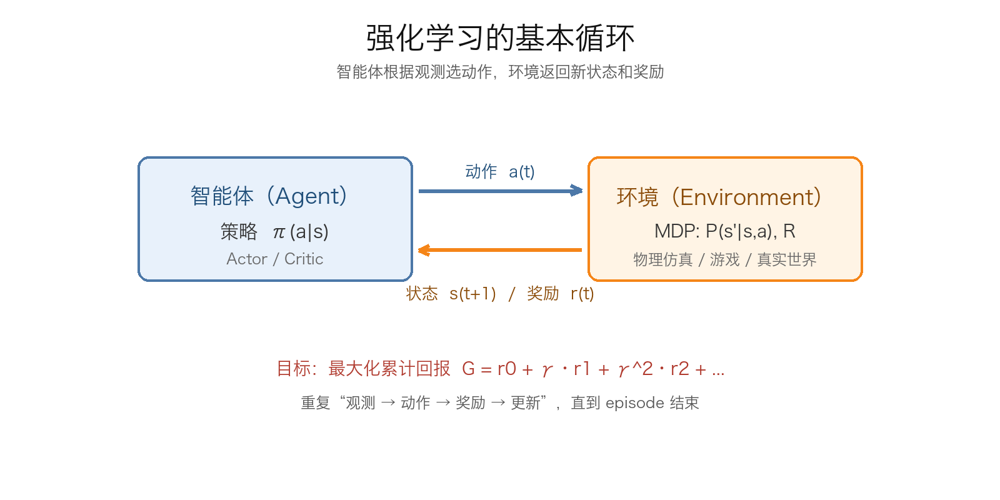

你可以把环境想象成一个黑盒，智能体往里扔动作，黑盒吐回新的状态和奖励。强化学习要做的，就是在这个黑盒上找到一个“扔动作”的规则，让长期奖励最大。

### MDP：把问题写成五元组

强化学习的问题通常用**马尔可夫决策过程**（Markov Decision Process，MDP）来描述。一个 MDP 是一个五元组：

$$
\mathcal{M}=(\mathcal{S},\mathcal{A},P,R,\gamma)
$$

- $\mathcal{S}$：状态空间，所有可能的状态。
- $\mathcal{A}$：动作空间，所有可能的动作。
- $P(s'|s,a)$：状态转移概率，在状态 $s$ 做动作 $a$ 后，转移到 $s'$ 的概率。
- $R(s,a,s')$：奖励函数，在状态 $s$ 做动作 $a$ 转移到 $s'$ 时得到的奖励。
- $\gamma\in[0,1]$：折扣因子，决定我们多看重未来的奖励。

这里的核心假设是**马尔可夫性**：下一步的状态只和当前状态、当前动作有关，和更早的历史无关。换句话说，当前状态已经包含了预测未来所需要的全部信息。

这个假设在现实中经常不成立。比如机器人只看到一张照片，它不知道自己的速度；只看到关节角，它不知道关节速度。这时候我们说的“状态”其实是“观测”，这类问题叫**部分可观测马尔可夫决策过程**（POMDP）。实际做的时候，我们通常会把最近几帧的观测拼起来，或者用 RNN 来补历史信息，把一个 POMDP 近似成 MDP。

在 Isaac Lab 里，`obs` 就是智能体看到的东西。它不一定等于完整的物理状态，但只要它包含了决策需要的信息，我们就可以把它当成 MDP 里的 $s$ 来用。

策略（policy）是强化学习要学的东西，记作 $\pi(a|s)$：在状态 $s$ 下选择动作 $a$ 的概率。如果策略是确定性的，就写成 $a=\pi(s)$；如果是随机性的，就写成 $a\sim\pi(\cdot|s)$。

为什么要用随机策略？一是探索，二是连续动作空间里高斯策略天然带噪声，三是有些任务的最优策略本身就是随机的（比如猜拳）。在机器人控制里，我们通常用高斯策略：网络输出动作均值 $\mu_\theta(s)$，再加一个可学习的标准差 $\sigma$，然后从 $\mathcal{N}(\mu_\theta(s),\sigma^2)$ 里采样动作。

### 回报和折扣

强化学习优化的不是某一步的奖励，而是**从当前时刻开始的累计奖励**，叫做回报（return）：

$$
G_t = r_t+\gamma r_{t+1}+\gamma^2 r_{t+2}+\cdots=\sum_{k=0}^{\infty}\gamma^k r_{t+k}
$$

其中 $r_t$ 是执行动作 $a_t$ 后拿到的奖励，$\gamma$ 是折扣因子。

为什么要折扣？有三个原因：

1. **未来的奖励不确定**。与其赌很久以后的大奖，不如先拿眼前确定的小奖。
2. **数学上更好处理**。有折扣的无穷级数在奖励有界时收敛；没有折扣的 continuing task 可能发散。
3. **让智能体有“时间偏好”**。$\gamma$ 越小，越短视；$\gamma$ 越接近 1，越有远见。

折扣因子有一个很直观的“有效视野”：

$$
\text{effective horizon}\approx\frac{1}{1-\gamma}
$$

$\gamma=0.9$ 大约看 10 步，$\gamma=0.99$ 大约看 100 步，$\gamma=0.999$ 大约看 1000 步。当然这只是数量级上的感觉，不是严格的截止。

举个例子：如果每一步都拿 1 分，一直拿下去，那么

$$
G_t=1+\gamma+\gamma^2+\cdots=\frac{1}{1-\gamma}
$$

$\gamma=0.9$ 时总回报是 10，$\gamma=0.99$ 时是 100。所以折扣因子越大，智能体越愿意为了长远利益牺牲眼前利益。

在机器人任务里，$\gamma$ 通常取 0.99 左右。太小，机器人只想着眼前这一步，不敢往前走；太大，信用分配会变得很难，训练方差也大。

### 价值函数和贝尔曼方程

有了回报，我们就可以给状态和动作“打分”了。

**状态价值函数** $V^\pi(s)$：从状态 $s$ 出发，按照策略 $\pi$ 一直走下去，能拿到的期望回报：

$$
V^\pi(s)=\mathbb{E}_{\pi}\left[G_t\mid S_t=s\right]
$$

**动作价值函数** $Q^\pi(s,a)$：在状态 $s$ 先做动作 $a$，然后再按照策略 $\pi$ 走下去，能拿到的期望回报：

$$
Q^\pi(s,a)=\mathbb{E}_{\pi}\left[G_t\mid S_t=s,A_t=a\right]
$$

这两个函数的关系很直接：

$$
V^\pi(s)=\sum_{a}\pi(a|s)Q^\pi(s,a)
$$

也就是说，状态的价值，是在这个状态下按策略选动作的 Q 值的加权平均。

**优势函数**（advantage）定义为：

$$
A^\pi(s,a)=Q^\pi(s,a)-V^\pi(s)
$$

它衡量的是：在状态 $s$ 下做动作 $a$，比按照当前策略“平均来看”好多少。$A>0$ 说明这个动作比平均水平好，$A<0$ 说明比平均水平差。后面 Actor-Critic 和 PPO 都会反复用到这个量。

价值函数不是凭空算出来的，它满足**贝尔曼方程**。对策略 $\pi$：

$$
V^\pi(s)=\sum_{a}\pi(a|s)\sum_{s'}P(s'|s,a)\left[R(s,a,s')+\gamma V^\pi(s')\right]
$$

$$
Q^\pi(s,a)=\sum_{s'}P(s'|s,a)\left[R(s,a,s')+\gamma\sum_{a'}\pi(a'|s')Q^\pi(s',a')\right]
$$

这两个式子的意思是：**当前的价值 = 眼前的奖励 + 折扣后的下一个状态的价值**。这就是“自举”（bootstrapping）的思想：用一个估计去更新另一个估计。

最优价值函数满足**贝尔曼最优方程**：

$$
V^*(s)=\max_{a}\sum_{s'}P(s'|s,a)\left[R(s,a,s')+\gamma V^*(s')\right]
$$

$$
Q^*(s,a)=\sum_{s'}P(s'|s,a)\left[R(s,a,s')+\gamma\max_{a'}Q^*(s',a')\right]
$$

最优策略就是每个状态都选 Q 值最大的动作：

$$
\pi^*(s)=\arg\max_{a}Q^*(s,a)
$$

所以，强化学习的一个核心任务，就是想办法把 $Q^*$ 估出来。估出来之后，策略自然就有了。

如果环境的 $P$ 和 $R$ 已知，我们可以直接用动态规划来算：反复套贝尔曼最优方程叫**值迭代**，先评估当前策略再改进叫**策略迭代**。但机器人的环境通常没有精确模型，我们只能通过采样去估计，这就是后面要讲的 model-free 方法。

你可以这样理解 $V$ 和 $Q$：

- $V(s)$ 是“这个状态好不好”；
- $Q(s,a)$ 是“在这个状态下做这个动作好不好”；
- $A(s,a)$ 是“这个动作比当前策略的平均水平好多少”。

比如机器人站在平地上，$V$ 很高；站在悬崖边，$V$ 很低。同样站在平地上，往前迈一步的 $Q$ 很高，往后仰的 $Q$ 很低。强化学习就是通过不断试错，把这些值估得越来越准。

### 强化学习算法地图

强化学习的算法很多，但大致可以按几个维度分类。

**按有没有环境模型分：**

- **Model-based**：先学一个环境模型 $P(s'|s,a)$ 和 $R$，然后用它来做规划。样本效率高，但模型误差会累积。
- **Model-free**：不学模型，直接学价值函数或策略。实现简单，适用范围广，但通常需要更多样本。

**按学什么分：**

- **Value-based**：学 $Q(s,a)$ 或 $V(s)$，然后根据价值选动作。Q-learning、SARSA、DQN 都属于这一类。
- **Policy-based**：直接学策略 $\pi_\theta(a|s)$，不显式学价值函数。REINFORCE 是代表。
- **Actor-Critic**：一边学策略（actor），一边学价值函数（critic）。A2C、PPO、SAC 都属于这一类。

**按数据怎么用来分：**

- **On-policy**：只用当前策略采到的数据来更新当前策略。策略一变，旧数据就基本不能用了。SARSA、REINFORCE、A2C、PPO 都是 on-policy。
- **Off-policy**：可以用旧策略采到的数据来更新当前策略。Q-learning、DQN、DDPG、TD3、SAC 都是 off-policy。

把它们放在一张表里：

| 算法 | 类型 | On/Off-policy | 动作空间 | 一句话 |
|:---|:---|:---:|:---|:---|
| Q-learning | Value-based | Off-policy | 离散 | 用贪心目标更新 Q 表 |
| SARSA | Value-based | On-policy | 离散 | 用实际下一步动作更新 Q 表 |
| DQN | Value-based + 神经网络 | Off-policy | 离散 | 用神经网络近似 Q 函数 |
| REINFORCE | Policy-based | On-policy | 离散/连续 | 用回报加权 log 概率 |
| A2C | Actor-Critic | On-policy | 离散/连续 | Actor 加 Critic，同步更新 |
| PPO | Actor-Critic | On-policy | 离散/连续 | 用 clip 限制策略更新幅度 |
| SAC / TD3 | Actor-Critic | Off-policy | 连续 | 样本效率高，适合连续控制 |

我们下面的顺序是：Q-learning → SARSA → DQN → 策略梯度 → Actor-Critic → PPO。这个顺序不是随意的，后面每一个算法都在解决前一个算法暴露出来的问题。

### Q-learning

Q-learning 是最经典的值函数算法。它维护一张 Q 表，表的行是状态，列是动作，单元格里是 $Q(s,a)$ 的估计。

一开始 Q 表可以全填 0。智能体在状态 $s$ 下用 $\varepsilon$-greedy 策略选动作：

- 以 $1-\varepsilon$ 的概率选当前 Q 值最大的动作；
- 以 $\varepsilon$ 的概率随机选一个动作。

执行动作 $a$，拿到奖励 $r$ 和下一个状态 $s'$，然后用下面的公式更新：

$$
Q(s,a)\leftarrow Q(s,a)+\alpha\left[r+\gamma\max_{a'}Q(s',a')-Q(s,a)\right]
$$

其中 $\alpha$ 是学习率。

这个公式里有几个关键量：

- $r+\gamma\max_{a'}Q(s',a')$ 叫做 **TD 目标**（temporal difference target），也就是“我这次实际拿到的奖励 + 我对未来的估计”。
- $r+\gamma\max_{a'}Q(s',a')-Q(s,a)$ 叫做 **TD 误差**，也就是“目标和我原来的估计差了多少”。
- 更新就是让 $Q(s,a)$ 朝着 TD 目标走一步，步长是 $\alpha$。

举个具体的数：假设当前 $Q(s,a)=0.2$，执行动作后拿到 $r=1$，下一个状态的最大 Q 值是 $0.5$，$\gamma=0.9$，$\alpha=0.1$。那么：

$$
\text{target}=1+0.9\times0.5=1.45
$$

$$
\text{TD error}=1.45-0.2=1.25
$$

$$
Q(s,a)\leftarrow0.2+0.1\times1.25=0.325
$$

你看，Q 值从 0.2 变成了 0.325，朝着“实际更好”的方向走了一步。

Q-learning 的一个重要特点是 **off-policy**：它用来采样的是 $\varepsilon$-greedy 策略，但更新目标里用的是 $\max_{a'}Q(s',a')$，也就是假设以后都选最好的动作。所以它学的是“最优策略”的 Q 值，而不是“当前行为策略”的 Q 值。你可以把它理解成：一边到处试，一边在心里盘算“如果我以后一直选最好的，会怎样”。

Q-learning 在表格足够小、每个状态-动作对都被访问足够多次、学习率逐渐减小的情况下，可以收敛到 $Q^*$。但现实中的机器人状态是连续的，关节角有无数种组合，Q 表根本存不下。这就是所谓的“维度灾难”。

### SARSA

SARSA 的名字来自它更新时用到的五个量：$s_t,a_t,r_t,s_{t+1},a_{t+1}$。

它的更新公式是：

$$
Q(s,a)\leftarrow Q(s,a)+\alpha\left[r+\gamma Q(s',a')-Q(s,a)\right]
$$

注意，这里用的是**实际在下一个状态选的动作 $a'$**，而不是 $\max_{a'}Q(s',a')$。

这个差别看起来很小，但含义完全不同：

- Q-learning 用 $\max$，学的是“最优策略”的 Q 值，所以是 off-policy。
- SARSA 用实际动作 $a'$，学的是“当前策略”的 Q 值，所以是 on-policy。

最经典的例子是**悬崖行走**（cliff walking）：一个网格世界，底部是一排悬崖，掉下去扣很多分，绕路走安全但慢。Q-learning 学到的策略通常贴着悬崖边走，因为它的目标策略假设以后不会乱走；SARSA 知道自己的行为策略里有 $\varepsilon$ 的随机探索，贴着悬崖走迟早会掉下去，所以它学到的路线会离悬崖远一点。

用一句话概括：

- **Q-learning 是“理论上最优，但探索时可能摔死”**；
- **SARSA 是“知道自己会犯错，所以走得保守一点”**。

| | Q-learning | SARSA |
|:---|:---|:---|
| 行为策略 | $\varepsilon$-greedy | $\varepsilon$-greedy |
| 目标策略 | greedy | $\varepsilon$-greedy |
| 类型 | off-policy | on-policy |
| 风格 | 激进 | 保守 |

在机器人任务里，如果你非常在意安全，SARSA 这种 on-policy 的思路会更保守；但现代深度强化学习里，大家更常用 PPO 这类 actor-critic 方法，SARSA 更多是帮你理解“on-policy 和 off-policy 到底差在哪”。

### DQN

Q-learning 的表格方法只能处理小规模离散问题。如果状态是图像，或者关节角是连续值，Q 表就废了。

DQN（Deep Q-Network）的想法很直接：**用神经网络来近似 Q 函数**。输入状态 $s$，输出每个动作的 Q 值；或者输入状态-动作对，输出一个 Q 值。对于离散动作，通常用前者：网络输出一个向量 $Q(s,\cdot;\theta)$，每个分量对应一个动作。

DQN 的损失函数是：

$$
L(\theta)=\mathbb{E}\left[\left(r+\gamma\max_{a'}Q(s',a';\theta^-)-Q(s,a;\theta)\right)^2\right]
$$

其中 $\theta$ 是当前网络的参数，$\theta^-$ 是目标网络的参数。

如果直接拿这个损失去训练，会遇到两个问题：

1. **样本相关**。连续采到的 $(s,a,r,s')$ 前后高度相关，神经网络会被“带偏”。
2. **目标不稳定**。TD 目标里也包含神经网络，你更新一次，目标就变一次，训练容易发散。

DQN 用两个技巧解决：

- **经验回放（replay buffer）**：把历史样本存起来，训练时随机抽一个 minibatch，打破相关性，也让一个样本可以被多次使用。
- **目标网络（target network）**：单独维护一个 $\theta^-$，隔一段时间才从 $\theta$ 复制一次。这样 TD 目标在一段时间内是固定的，训练更稳定。

DQN 的训练流程大概是：

1. 用当前网络和 $\varepsilon$-greedy 策略与环境交互，把 $(s,a,r,s',done)$ 存进 replay buffer。
2. 从 buffer 里随机采样一个 batch。
3. 用目标网络算 TD 目标。
4. 算损失，反向传播，更新当前网络。
5. 每隔 $C$ 步，把当前网络的参数复制给目标网络。
6. 重复。

DQN 也有几个常见改进：

- **Double DQN**：解决 Q 值高估。普通 DQN 用目标网络既选动作又评估动作，容易把噪声大的动作选成最大值；Double DQN 用当前网络选动作，用目标网络评估：

$$
y=r+\gamma Q\left(s',\arg\max_{a'}Q(s',a';\theta);\theta^-\right)
$$

- **Dueling DQN**：把 Q 拆成状态价值 $V(s)$ 和优势 $A(s,a)$，让网络更容易学到“这个状态好不好”，而不必对每个动作都重新学一遍。
- **优先经验回放（Prioritized Replay）**：TD 误差大的样本更值得学，采样时给它们更高的概率。
- **Noisy Net**：把 $\varepsilon$-greedy 的随机性放进网络参数里，让探索更“聪明”。

但 DQN 有一个硬伤：**它只能处理离散动作**。因为更新时要算 $\max_{a'}Q(s',a')$，动作必须是有限个、可以枚举的。双足机器人的关节力矩是连续的，你不可能枚举所有力矩值。所以连续控制通常不用 DQN，而是用策略梯度或 actor-critic。

### 策略梯度法

值函数方法的路子是“先学 Q，再根据 Q 选动作”。策略梯度方法更直接：**直接把策略参数化，然后沿着让回报变大的方向更新参数**。

设策略是 $\pi_\theta(a|s)$，目标是最大化期望回报：

$$
J(\theta)=\mathbb{E}_{\tau\sim\pi_\theta}\left[R(\tau)\right]
$$

其中 $\tau=(s_0,a_0,r_0,s_1,a_1,r_1,\dots)$ 是一条轨迹，$R(\tau)=\sum_t\gamma^t r_t$ 是这条轨迹的回报。

我们想算 $\nabla_\theta J(\theta)$。直接对期望求导不好算，因为轨迹的分布也依赖 $\theta$。这里用一个技巧，叫**对数导数技巧**（log-derivative trick）：

$$
\nabla_\theta P(\tau)=P(\tau)\nabla_\theta\log P(\tau)
$$

而

$$
\log P(\tau)=\log P(s_0)+\sum_t\left[\log\pi_\theta(a_t|s_t)+\log P(s_{t+1}|s_t,a_t)\right]
$$

其中 $P(s_0)$ 和 $P(s_{t+1}|s_t,a_t)$ 都不依赖 $\theta$，所以

$$
\nabla_\theta\log P(\tau)=\sum_t\nabla_\theta\log\pi_\theta(a_t|s_t)
$$

代回去就得到：

$$
\nabla_\theta J(\theta)=\mathbb{E}_{\tau\sim\pi_\theta}\left[\sum_t\nabla_\theta\log\pi_\theta(a_t|s_t)R(\tau)\right]
$$

这个式子的直观含义是：**如果一条轨迹的回报高，就把这条轨迹里所有动作的概率都调高；如果回报低，就调低**。当然，更合理的做法是只看动作之后的回报，而不是整条轨迹的回报，于是写成：

$$
\nabla_\theta J(\theta)=\mathbb{E}_{\tau\sim\pi_\theta}\left[\sum_t\nabla_\theta\log\pi_\theta(a_t|s_t)G_t\right]
$$

其中 $G_t=\sum_{k=0}^{\infty}\gamma^k r_{t+k}$ 是从第 $t$ 步开始的回报。这就是 **REINFORCE** 算法。

REINFORCE 的流程很简单：

1. 用当前策略采样一条完整轨迹。
2. 计算每个时刻的回报 $G_t$。
3. 算梯度 $\sum_t\nabla_\theta\log\pi_\theta(a_t|s_t)G_t$。
4. 用梯度上升更新 $\theta$。

它的优点是简单、能处理连续动作、能学随机策略。缺点是**方差很大**：同一条策略，采样两次，回报可能差很多，梯度也跟着抖。为了减小方差，我们引入一个**基线** $b(s)$：

$$
\nabla_\theta J(\theta)=\mathbb{E}\left[\sum_t\nabla_\theta\log\pi_\theta(a_t|s_t)\left(G_t-b(s_t)\right)\right]
$$

只要 $b(s)$ 不依赖动作，减去它不会改变梯度的期望，但会显著减小方差。最常用的基线就是状态价值函数 $V(s)$，于是 $G_t-b(s_t)$ 就近似成了优势 $A(s_t,a_t)$。

策略梯度是 **on-policy** 的：梯度里的期望是对当前策略 $\pi_\theta$ 采样的，策略一更新，旧数据就不能直接用了。所以它通常样本效率不高，需要大量交互。

### Actor-Critic

Actor-Critic 把前面两条路线合在了一起：

- **Actor**：策略网络 $\pi_\theta(a|s)$，负责选动作。
- **Critic**：价值网络 $V_\phi(s)$，负责评价状态好坏。

Actor 用 Critic 给出的优势来更新：

$$
\nabla_\theta J(\theta)\approx\mathbb{E}\left[\nabla_\theta\log\pi_\theta(a|s)A(s,a)\right]
$$

Critic 则用 TD 误差来更新：

$$
\delta_t=r_t+\gamma V_\phi(s_{t+1})-V_\phi(s_t)
$$

$$
L(\phi)=\mathbb{E}\left[\delta_t^2\right]
$$

你可以把 Critic 理解成“教练”，Actor 理解成“运动员”。运动员做完动作，教练根据结果告诉他“这次比预期好还是差”，运动员就朝着“比预期好”的方向调整。

优势怎么估？最简单的是**一步 TD 误差**：

$$
A_t\approx r_t+\gamma V(s_{t+1})-V(s_t)
$$

它偏差大，但方差小。另一种极端是用 Monte Carlo 回报：

$$
A_t\approx G_t-V(s_t)
$$

它无偏，但方差大。**GAE（Generalized Advantage Estimation）** 在两者之间做插值：

$$
\delta_t=r_t+\gamma V(s_{t+1})-V(s_t)
$$

$$
\hat{A}_t^{\mathrm{GAE}(\gamma,\lambda)}=\sum_{l=0}^{\infty}(\gamma\lambda)^l\delta_{t+l}
$$

- $\lambda=0$ 时，GAE 退化成一步 TD 误差，偏差大、方差小；
- $\lambda=1$ 时，GAE 退化成 Monte Carlo 回报，偏差小、方差大；
- 实际常用 $\lambda=0.95$，在偏差和方差之间取一个折中。真实实现不会真的加到无穷，而是在 episode 结束或者 bootstrap 的地方截断。

A2C（Advantage Actor-Critic）就是同步版本的 Actor-Critic：开多个环境并行采样，拼成一个 batch，算优势，然后同时更新 actor 和 critic。A3C 是它的异步版本，现在用得更少，因为并行环境 + 同步更新在 GPU 上更划算。

Actor-Critic 的优点是：比纯策略梯度方差小，比纯值函数方法更容易处理连续动作。PPO 就是 Actor-Critic 家族里最常用的一个。

### PPO

PPO（Proximal Policy Optimization）是现在机器人强化学习里最常用的算法之一，也是 Isaac Lab 里 locomotion 任务常见的默认选择。它属于 on-policy 的 Actor-Critic，核心思想是：**每次更新策略时，别让新策略离旧策略太远**。

为什么要限制？因为策略梯度是用旧策略采的数据来估当前策略的梯度。如果一次更新太猛，新策略跑到一个完全不同的地方，旧数据就完全失效了，训练会崩。TRPO 用 KL 散度做硬约束，但实现复杂；PPO 用了一个更简单的 clip，效果差不多，所以更受欢迎。

PPO 定义新旧策略的概率比：

$$
r_t(\theta)=\frac{\pi_\theta(a_t|s_t)}{\pi_{\theta_{\mathrm{old}}}(a_t|s_t)}
$$

如果 $r_t=1$，说明新旧策略对这个动作的概率一样；$r_t>1$ 说明新策略更倾向于这个动作；$r_t<1$ 说明更不倾向。

PPO 的 clipped surrogate objective 是：

$$
L^{\mathrm{CLIP}}(\theta)=\mathbb{E}_t\left[\min\left(r_t(\theta)\hat{A}_t,\ \mathrm{clip}\left(r_t(\theta),1-\epsilon,1+\epsilon\right)\hat{A}_t\right)\right]
$$

其中 $\epsilon$ 通常取 0.2，$\hat{A}_t$ 是优势估计。

这个式子在干什么？分两种情况：

- 如果 $\hat{A}_t>0$（这个动作比平均好），我们希望提高它的概率，也就是让 $r_t$ 变大。但 $r_t$ 一旦超过 $1+\epsilon$，clip 就把目标截断，再往上提高也没有额外收益，所以策略不会走太远。
- 如果 $\hat{A}_t<0$（这个动作比平均差），我们希望降低它的概率，也就是让 $r_t$ 变小。但 $r_t$ 一旦低于 $1-\epsilon$，clip 同样截断，避免过度惩罚。

所以 clip 的作用不是“硬限制”，而是一种**软约束**：它让策略在旧策略附近更新，出了这个范围就没有梯度奖励了。

PPO 的完整损失通常包括三部分：

$$
L(\theta,\phi)=-L^{\mathrm{CLIP}}(\theta)+c_1L^{\mathrm{VF}}(\phi)-c_2\mathcal{H}\left[\pi_\theta(\cdot|s_t)\right]
$$

- $L^{\mathrm{CLIP}}$：策略损失，前面讲过。
- $L^{\mathrm{VF}}$：价值损失，通常是 $(V_\phi(s_t)-\hat{R}_t)^2$，让 critic 拟合回报。
- $\mathcal{H}$：策略熵，鼓励探索；熵越大，策略越随机，熵太小策略会很快变得确定。$c_2$ 通常取 0 到 0.01。
- $c_1$：价值损失的系数，通常取 0.5 左右。

PPO 的训练流程大概是：

1. 用当前策略在 $N$ 个并行环境里采样 $T$ 步，收集 $(s_t,a_t,r_t,s_{t+1},done_t)$ 和旧策略的 log 概率。
2. 用 GAE 计算每个时刻的优势 $\hat{A}_t$ 和回报 $\hat{R}_t$。
3. 对优势做归一化（减均值、除标准差），让训练更稳。
4. 把采样数据打乱，分成 minibatch，做 $K$ 个 epoch 的更新：
   - 算新策略的 log 概率和概率比 $r_t$；
   - 算 clipped policy loss；
   - 算 value loss 和 entropy bonus；
   - 反向传播，更新 actor 和 critic。
5. 扔掉这批数据，用新策略重新采样，重复。

注意第 5 步：PPO 是 on-policy 的，虽然同一批数据可以反复训几个 epoch，但更新完之后这批数据就过期了，不能一直留着用。这也是为什么 PPO 需要大量并行环境：它要在短时间内采足够多的数据。

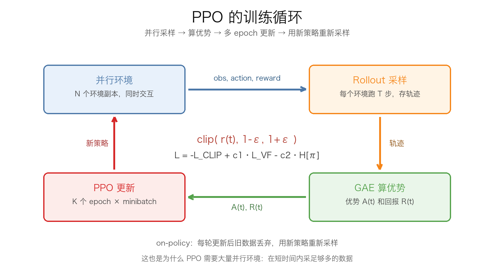

PPO 在连续动作空间里通常这样用：

- Actor 网络输出动作均值 $\mu_\theta(s)$；
- 标准差 $\sigma$ 可以作为可学习的参数，也可以由网络输出；
- 动作从 $\mathcal{N}(\mu_\theta(s),\sigma^2)$ 采样；
- 实际执行前，把动作裁剪或缩放到合法范围；
- 计算 log 概率时，要把动作变换的雅可比项算进去（如果用 tanh 压缩的话）。

在 Isaac Lab 里，动作通常是关节位置目标，策略输出的动作会被映射或裁剪到关节范围内。你不需要自己手写 PPO，但要知道这些超参数是干什么的。

PPO 的常用超参数（只是起点，不是圣经）：

| 超参数 | 常用值 | 作用 |
|:---|:---:|:---|
| clip range $\epsilon$ | 0.2 | 限制每次策略更新的幅度 |
| discount $\gamma$ | 0.99 | 看多远 |
| GAE $\lambda$ | 0.95 | 偏差和方差的折中 |
| learning rate | $3\times10^{-4}$ | Adam 的学习率 |
| epochs $K$ | 5~10 | 同一批数据训几遍 |
| num minibatches | 4~8 | 把 rollout 数据分成几份 |
| entropy coef $c_2$ | 0.0~0.01 | 鼓励探索 |
| value coef $c_1$ | 0.5 | 价值损失的权重 |
| max grad norm | 0.5~1.0 | 防止梯度爆炸 |
| rollout steps $T$ | 24~64 | 每个环境每次采多少步 |
| parallel envs $N$ | 几千个 | 并行采样，提高吞吐 |

为什么 PPO 这么受欢迎？几个原因：

- 实现相对简单，不像 TRPO 那样要算 Fisher 矩阵和共轭梯度。
- 训练稳定，对超参数没有 DQN 那么敏感。
- 能处理离散和连续动作。
- 天然适合并行环境，采样效率可以通过堆环境数量来补。
- 在机器人 locomotion 里已经被验证过很多次。

但 PPO 不是魔法。它也有自己的问题：

- **样本效率不高**。on-policy，旧数据不能反复用，所以需要大量环境交互。
- **对 reward 设计很敏感**。reward 写歪了，PPO 会非常认真地学歪。
- **对观测归一化、优势归一化、价值损失尺度敏感**。这些没弄好，训练会抖或者不收敛。
- **探索不足**。熵系数太小、初始策略太差，可能早早收敛到局部最优。

### 强化学习里的几个坑

#### 1. reward 设计

强化学习里最重要的东西不是算法，是 reward。算法只是帮你最大化 reward，至于这个 reward 是不是你真正想要的东西，算法不负责。

比如训练机器人往前走：

- 如果你只奖励“向前速度”，机器人可能会学会往前扑倒，因为扑倒的瞬间速度很大；
- 如果你只奖励“不摔倒”，机器人可能会学会站着不动；
- 如果你奖励“向前速度 + 保持直立 + 足底抬高 + 动作平滑 - 能耗”，它才可能学会像样地走。

这就是所谓的 **reward hacking**：模型找到了一个能拿高分、但并不是你想要的行为。写 reward 的时候要反复问自己：**如果我是模型，我会怎么作弊？**

reward 一般分两种：

- **稀疏奖励（sparse）**：只有成功时给 1，其他时候给 0。难学，因为中间没有反馈。
- **稠密奖励（dense）**：每一步都给一点反馈，比如前进距离、姿态、能耗。好学，但设计不好会引入副作用。

实际做机器人，通常是稠密奖励 + 终止条件 + 少量稀疏奖励的组合。后面 Isaac Lab 那一章会具体讲怎么配。

#### 2. 探索和利用

- **探索（exploration）**：试试没试过的动作，可能发现更好的策略。
- **利用（exploitation）**：用当前已知最好的动作，保证短期收益。

DQN 用 $\varepsilon$-greedy 探索；PPO 用随机策略的熵来探索；连续控制里还可以给动作加噪声。探索太少，会卡在局部最优；探索太多，学得慢、行为抖。

#### 3. 折扣因子

$\gamma$ 太小，机器人目光短浅，只想着眼前这一步；$\gamma$ 太大，信用分配变难，方差变大。locomotion 任务常用 0.99，偶尔用 0.995 或 0.999，具体要看任务的时间尺度。

#### 4. 终止和超时

这两个东西一定要分清楚：

- **terminated**：任务真的失败了，比如机器人摔了、游戏输了。这个时候不应该再自举，因为后面没有未来了。
- **truncated**：时间到了，但任务没失败，比如 episode 到了最大步数。这个时候应该用 $V(s_{t+1})$ 自举，因为后面理论上还有未来。

在 Isaac Lab 里，很多训练不收敛的问题，最后都发现是 timeout 的时候没有 bootstrap，或者 done 的处理写错了。

#### 5. 观测和奖励的归一化

神经网络的输入最好在差不多的尺度上。关节角可能是 $[-\pi,\pi]$，速度可能是 $[-10,10]$，接触力可能是几百牛，如果直接喂给网络，训练会很不稳定。常见做法：

- 观测归一化（running mean/std）；
- 奖励缩放（reward scaling）；
- 优势归一化（advantage normalization）；
- 梯度裁剪。

#### 6. 评估

训练 reward 高，不代表任务完成得好。你要分开看：

- **episode return**：累计奖励，反映训练目标。
- **task success rate**：任务成功率，比如走了多远、有没有到终点。
- **behavior metrics**：摔倒次数、能耗、关节抖动、步态对称性。
- **不同 seed 的方差**：强化学习对随机种子很敏感，跑一个 seed 的结果不能说明问题。

评估的时候还要注意：训练时用的是随机策略（带探索噪声），评估时通常用确定性策略（取均值），两者的表现可能差很多。

#### 7. sim-to-real

仿真里训好的策略，搬到真机上往往会性能下降。原因包括：

- 仿真和现实的物理参数不一致（质量、摩擦、电机模型、延迟）；
- 传感器噪声；
- 地面不是平的；
- 执行器有延迟和饱和。

解决办法包括域随机化（domain randomization）、系统辨识、观测噪声、动作延迟、执行器建模等。这些在 Isaac Lab 那一章会展开。

### 从 RL 到 Isaac Lab

把这一章的概念映射到 Isaac Lab，大概是这样：

- **环境** = MDP，`env.step(action)` 返回 `obs, reward, terminated, truncated, info`。
- **状态/观测** = `obs`，包括关节角、关节速度、机身姿态、角速度、上一帧动作、足底接触等。
- **动作** = 关节位置目标或力矩，通常是连续值。
- **奖励** = 你自己写的 reward function。
- **策略** = 一个 MLP，输入 `obs`，输出动作均值（和标准差）。
- **价值函数** = 另一个 MLP，输入 `obs`，输出一个标量 $V(s)$。
- **PPO** = 负责采样、算 GAE、算 clipped loss、更新 actor 和 critic 的训练器。

所以你看，前面讲的 MLP、激活函数、损失函数、梯度下降、反向传播，到这里全都用上了：

- Actor 和 Critic 都是 MLP；
- 策略网络输出高斯分布的均值，价值网络输出标量；
- PPO 的 loss 是自定义的，但还是要反向传播、用 Adam 更新；
- 过拟合、归一化、学习率这些问题，在 RL 里一个都不会少。

### 强化学习小结

这一章内容很多，但核心其实可以压缩成下面几句话：

- **强化学习**：智能体在环境里试错，根据 reward 调整策略，最大化长期回报。
- **MDP**：用 $(S,A,P,R,\gamma)$ 描述问题；马尔可夫性是说当前状态包含了预测未来所需的信息。
- **回报**：$G_t=\sum_k\gamma^k r_{t+k}$；$\gamma$ 决定看多远。
- **价值函数**：$V(s)$ 是状态好坏，$Q(s,a)$ 是动作好坏，$A=Q-V$ 是动作比平均好多少。
- **贝尔曼方程**：当前价值 = 眼前奖励 + 折扣后的未来价值。
- **Q-learning**：off-policy，用 $\max$ 目标更新 Q 表；**SARSA**：on-policy，用实际下一步动作更新。
- **DQN**：用神经网络 + replay buffer + target network 近似 Q 函数，适合离散动作。
- **策略梯度**：直接学 $\pi_\theta(a|s)$，用 $\nabla\log\pi\cdot G$ 更新；REINFORCE 是代表，方差大，需要 baseline。
- **Actor-Critic**：Actor 学策略，Critic 学价值，用优势 $A$ 更新 Actor；GAE 用来估优势。
- **PPO**：Actor-Critic + clipped ratio，限制每次策略更新幅度；on-policy，适合并行环境，是 Isaac Lab 里的常客。

如果你只记一句话，那就记这个：

> **PPO 用 Actor 输出动作分布，用 Critic 估计状态价值，用 GAE 算优势，用 clip 把每次策略更新限制在一个小范围内。**

下一章，我们就把这套东西搬到 Isaac Lab 里，让双足机器人真正走起来。

## Isaac Lab

前面我们把机器学习、深度神经网络、强化学习都过了一遍。现在终于到了最后一步：把这些东西真正放到仿真里，让一个双足机器人学会走路。

这一章会非常“操作向”。我不会只告诉你“Isaac Lab 很强大”，而是会把安装、建任务、改观测、改动作、写 reward、训练、看曲线、调参、导出、部署这一整套流程拆开，尽量让你照着做就能跑起来。

> 版本说明：下面的命令和配置以 **Isaac Lab 2.x + Isaac Sim 4.5 + RSL-RL** 为例。Isaac Lab 更新很快，类名、字段名、脚本路径都可能变；如果发现对不上，以你安装版本里的 `scripts/environments/list_envs.py` 输出和源码为准。思路是不变的。

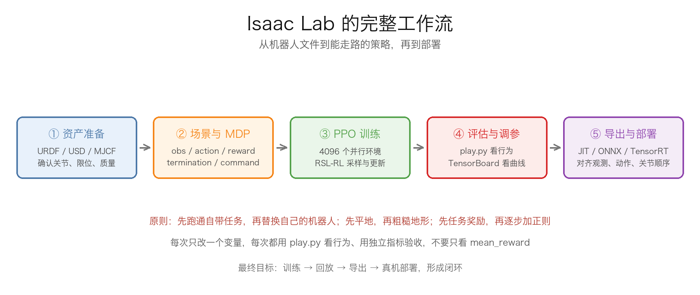

### 这一章要做什么

我们的目标不是“跑一个 demo”，而是走完下面这条链路：

1. 装好 Isaac Sim + Isaac Lab，能打开一个空场景。
2. 跑通一个自带的 locomotion 任务，确认训练、回放、日志都正常。
3. 复制一个自带任务，改成自己的双足机器人。
4. 定义观测、动作、奖励、终止条件、命令和域随机化。
5. 用 RSL-RL 的 PPO 训练，学会看 TensorBoard。
6. 从平地开始，逐步加正则项，再过渡到粗糙地形和课程学习。
7. 导出 JIT/ONNX，部署到真机，处理仿真和现实的差距。

如果你还没有自己的双足机器人模型，建议先用 Isaac Lab 自带的四足或人形任务把流程跑通，再替换资产。不要一上来就拿一个没调好的 URDF 硬训，最后你分不清是模型问题、配置问题还是 reward 问题。

### 一、安装：先把环境跑起来

#### 1.1 硬件和系统检查

Isaac Lab 对环境和显卡是有要求的，先别急着敲安装命令，先确认下面几项：

- **操作系统**：Ubuntu 22.04 最稳；Ubuntu 20.04 也能用，但依赖和驱动更麻烦。Windows 建议用 WSL2 + Ubuntu 22.04，或者干脆装双系统；原生 Windows 支持不如 Linux。
- **GPU**：NVIDIA 显卡，至少 8GB 显存；24GB 的 RTX 3090/4090 跑 4096 个环境会舒服很多。
- **驱动**：NVIDIA 驱动 535 以上；`nvidia-smi` 能正常显示显卡和 CUDA 版本。
- **内存**：建议 32GB 以上；Isaac Sim 本身 + 4096 个环境 + 日志，16GB 会比较紧。
- **硬盘**：至少预留 50GB；Isaac Sim、USD 资产、shader cache、checkpoint 都很占空间。

先在终端里跑：

```shell
nvidia-smi
python3 --version
free -h
df -h
```

`nvidia-smi` 右上角会显示 `CUDA Version`，这个是驱动支持的最高 CUDA 版本，不一定等于你系统里装的 CUDA Toolkit 版本。PyTorch 和 Isaac Sim 一般会自带所需的 CUDA 运行库，所以不用太纠结 `nvcc --version` 和它完全一致，但驱动不能太旧。

#### 1.2 创建 conda 环境

强烈建议用 conda 隔离环境，不要往系统 Python 里装：

```shell
conda create -n isaaclab python=3.10 -y
conda activate isaaclab
python -m pip install --upgrade pip
```

后面所有命令都要在 `isaaclab` 这个环境里执行。如果你换了终端，记得先 `conda activate isaaclab`。

#### 1.3 安装 PyTorch

先装和 CUDA 匹配的 PyTorch。下面以 CUDA 12.1 为例：

```shell
pip install torch==2.5.1 torchvision==0.20.1 --index-url https://download.pytorch.org/whl/cu121
```

装完验证一下：

```shell
python -c "import torch; print(torch.__version__); print(torch.cuda.is_available()); print(torch.cuda.get_device_name(0))"
```

如果 `torch.cuda.is_available()` 是 `False`，先别继续装 Isaac Lab，先把 PyTorch 和驱动的问题解决。常见原因是驱动太旧、装成了 CPU 版本，或者 CUDA 版本不匹配。

#### 1.4 安装 Isaac Sim

Isaac Lab 是建立在 Isaac Sim 之上的，所以要先装 Isaac Sim。用 pip 安装比较省事：

```shell
pip install 'isaacsim[all,extscache]==4.5.0' --extra-index-url https://pypi.nvidia.com
```

这个包很大，第一次下载可能要很久。装完之后，第一次启动 Isaac Sim 还会下载扩展、编译 shader，可能又需要十几分钟，属于正常现象。

第一次运行可能会弹 EULA（用户协议）。在无头模式或者 CI 里，可以设置：

```shell
export OMNI_KIT_ACCEPT_EULA=YES
```

#### 1.5 安装 Isaac Lab

```shell
git clone https://github.com/isaac-sim/IsaacLab.git
cd IsaacLab
sudo apt install cmake build-essential -y
./isaaclab.sh --install
```

`--install` 会安装 Isaac Lab 的 Python 包和依赖。如果你只想用 RSL-RL，也可以单独装：

```shell
./isaaclab.sh --install rsl_rl
```

RSL-RL 是 ETH Zurich 的 PPO 实现，也是 Isaac Lab 里最常用的训练框架之一。我们后面的训练命令都基于它。

#### 1.6 验证安装

先跑一个空场景：

```shell
./isaaclab.sh -p scripts/tutorials/00_sim/create_empty.py
```

如果弹出一个空的 3D 窗口，说明 Isaac Sim 和 Isaac Lab 基本通了。没有显示器或者远程服务器上，可以加 `--headless`：

```shell
./isaaclab.sh -p scripts/tutorials/00_sim/create_empty.py --headless
```

然后列出所有已注册的任务：

```shell
./isaaclab.sh -p scripts/environments/list_envs.py
```

你会看到一长串任务名，比如 `Isaac-Velocity-Flat-Anymal-C-v0`、`Isaac-Velocity-Rough-Anymal-C-v0`、`Isaac-Velocity-Flat-H1-v0` 等。任务名以你安装的版本为准，后面我们把 `--task` 换成你在这里看到的名字。

再确认一下 Isaac Lab 的版本：

```shell
./isaaclab.sh -p -c "import isaaclab; print(isaaclab.__version__)"
```

注意：**一定要用 `./isaaclab.sh -p` 来跑 Python 脚本**，不要直接 `python train.py`。`isaaclab.sh` 会帮你设置 Isaac Sim 的扩展路径、USD 库路径和环境变量；直接跑很容易出现 `ModuleNotFoundError` 或者 Isaac Sim 扩展加载失败。

#### 1.7 安装常见问题

| 现象 | 可能原因 | 处理 |
|:---|:---|:---|
| `ModuleNotFoundError: No module named 'isaaclab'` | 没激活环境，或者没装 Isaac Lab | `conda activate isaaclab`，重新执行 `./isaaclab.sh --install` |
| 启动时提示 EULA | 没有接受用户协议 | `export OMNI_KIT_ACCEPT_EULA=YES` |
| `GLIBCXX_3.4.xx not found` | conda 的 libstdc++ 和系统库冲突 | 更新 conda，或 `conda install -c conda-forge libstdcxx-ng` |
| 无头服务器上报 display 错误 | 没有图形界面 | 加 `--headless`；远程调试可以用 Isaac Sim 的 livestream |
| 启动很慢、卡在 shader | 第一次编译 shader | 第一次多等几分钟，之后会快很多 |
| GPU 显存不够 | 环境数太多 / 同时开了 GUI | 降低 `--num_envs`，关掉其他占显存的程序 |
| pip 下载慢 | 网络问题 | 换镜像，或者用代理；Isaac Sim 的包只能用 NVIDIA 的 index |

安装这一步的验收标准很简单：`create_empty.py` 能打开空场景，`list_envs.py` 能打印任务列表。只要这两个通了，后面的问题基本都是配置问题，不是环境问题。

### 二、先跑一个自带任务

在自己写任务之前，先跑通一个自带任务。这一步是为了确认“训练—日志—回放—导出”整条链路是通的。

#### 2.1 选一个 locomotion 任务

从 `list_envs.py` 的输出里找一个速度跟踪任务，比如：

- `Isaac-Velocity-Flat-Anymal-C-v0`：四足，平地；
- `Isaac-Velocity-Rough-Anymal-C-v0`：四足，粗糙地形；
- `Isaac-Velocity-Flat-H1-v0`：人形/双足，平地（如果你的版本有）。

先跑四足最稳，因为它的配置最成熟；等流程跑通，再换双足。

#### 2.2 用少量环境做冒烟测试

```shell
./isaaclab.sh -p scripts/reinforcement_learning/rsl_rl/train.py \
    --task=Isaac-Velocity-Flat-Anymal-C-v0 \
    --headless \
    --num_envs 64 \
    --max_iterations 5
```

这个命令只训练 5 次迭代，目的是看它能不能正常启动、采样、更新、写日志。你会看到类似下面的输出：

```text
[INFO] Logging experiment in directory: logs/rsl_rl/anymal_c_flat/...
[INFO] Training policy...
Learning iteration 0/5 ...
```

如果这里就报错，先别改自定义任务，先把这个自带任务跑通。大部分“训练不了”的问题，在冒烟测试阶段就会暴露。

#### 2.3 看日志和 checkpoint

训练日志在：

```text
logs/rsl_rl/<experiment_name>/<run_name>/
```

里面有：

- `model_*.pt`：checkpoint；
- `params/`：这次训练用的配置；
- `summaries/`：TensorBoard 日志；
- `exported/`：`play.py` 运行时导出的 JIT/ONNX 模型（如果版本支持自动导出）。

用 TensorBoard 看（没装的话先 `pip install tensorboard`）：

```shell
tensorboard --logdir=logs/rsl_rl --port=6006
```

浏览器打开 `http://localhost:6006`。先看 `Train/mean_reward` 和 `Train/mean_episode_length` 有没有动；只训练 5 次迭代不会学到东西，但曲线应该有数据。

#### 2.4 回放

```shell
./isaaclab.sh -p scripts/reinforcement_learning/rsl_rl/play.py \
    --task=Isaac-Velocity-Flat-Anymal-C-v0 \
    --num_envs 16 \
    --checkpoint=logs/rsl_rl/anymal_c_flat/<run_name>/model_<iteration>.pt
```

冒烟测试只跑 5 次迭代，可能还没有到 `save_interval`，所以不一定有 checkpoint。如果没有，把 `--max_iterations` 改成 100 左右再跑一次，或者直接跳过回放，先确认训练日志正常。

有头模式下会打开窗口，你能看到机器人在动。如果动作很怪，正常，因为只训练了 5 次迭代；这一步只是确认回放链路通。

#### 2.5 目录结构

后面我们会频繁改文件，先熟悉一下 Isaac Lab 的目录：

```text
IsaacLab/
├── source/
│   ├── isaaclab/                    # 核心库：环境、管理器、传感器、资产
│   ├── isaaclab_tasks/              # 自带任务
│   └── isaaclab_rl/                 # RL 框架封装（RSL-RL、SB3、SKRL 等）
├── scripts/
│   ├── tutorials/                   # 教程脚本
│   ├── environments/list_envs.py    # 列出任务
│   └── reinforcement_learning/
│       └── rsl_rl/
│           ├── train.py             # 训练入口
│           └── play.py              # 回放 / 导出入口
└── logs/                            # 训练日志
```

我们自定义的任务一般放在：

```text
source/isaaclab_tasks/isaaclab_tasks/manager_based/locomotion/velocity/config/<你的机器人>/
```

这是最快的方式：直接复制一个自带任务，改一改就能跑。等你熟悉了，再把它拆成独立的 extension 包。

### 三、自定义任务：从模板开始

#### 3.1 复制模板

以四足的速度任务为模板：

```shell
cd source/isaaclab_tasks/isaaclab_tasks/manager_based/locomotion/velocity/config
cp -r anymal_c my_biped
cd my_biped
```

你会看到类似这样的文件：

```text
my_biped/
├── __init__.py
├── flat_env_cfg.py
├── rough_env_cfg.py
└── agents/
    └── rsl_rl_ppo_cfg.py
```

把里面的类名、任务 ID、机器人配置改成你自己的。先不要删东西，先让复制出来的任务能跑，再一点点改。

然后在上一级 `config/__init__.py` 里加上：

```python
from . import my_biped
```

不加这一行，`list_envs.py` 是看不到你的任务的。这是很多人第一次自定义任务时踩的坑：文件写了，任务就是不出来。

#### 3.2 注册 Gymnasium 任务

在 `my_biped/__init__.py` 里注册任务：

```python
import gymnasium as gym

from . import agents

gym.register(
    id="My-Biped-Flat-v0",
    entry_point="isaaclab.envs:ManagerBasedRLEnv",
    disable_env_checker=True,
    kwargs={
        "env_cfg_entry_point": f"{__name__}.flat_env_cfg:MyBipedFlatEnvCfg",
        "rsl_rl_cfg_entry_point": f"{agents.__name__}.rsl_rl_ppo_cfg:MyBipedPPORunnerCfg",
    },
)
```

- `id`：任务名，训练时 `--task=My-Biped-Flat-v0`。
- `entry_point`：Manager-based 环境类。
- `env_cfg_entry_point`：环境配置类，格式是 `模块:类名`。
- `rsl_rl_cfg_entry_point`：RSL-RL 的训练配置类。

粗糙地形再注册一个：

```python
gym.register(
    id="My-Biped-Rough-v0",
    entry_point="isaaclab.envs:ManagerBasedRLEnv",
    disable_env_checker=True,
    kwargs={
        "env_cfg_entry_point": f"{__name__}.rough_env_cfg:MyBipedRoughEnvCfg",
        "rsl_rl_cfg_entry_point": f"{agents.__name__}.rsl_rl_ppo_cfg:MyBipedPPORunnerCfg",
    },
)
```

可以用同一个 runner 配置，也可以给粗糙地形单独写一个。

#### 3.3 机器人资产：URDF / USD

Isaac Lab 支持 USD、URDF、MJCF。USD 是 Omniverse 原生格式，加载最快；URDF 最通用；MJCF 适合从 MuJoCo 迁过来。

最省事的做法是先用 URDF，让 Isaac Lab 自动转 USD：

```python
import isaaclab.sim as sim_utils
from isaaclab.assets import ArticulationCfg
from isaaclab.actuators import ImplicitActuatorCfg

MY_BIPED_CFG = ArticulationCfg(
    spawn=sim_utils.UrdfFileCfg(
        asset_path="/absolute/path/to/my_biped.urdf",
        usd_dir="/absolute/path/to/usd",
        usd_file_name="my_biped.usd",
        fix_base=False,               # 双足是浮动基座，不能把根关节固定死
        force_usd_conversion=True,    # URDF 改了以后强制重新转换
    ),
    init_state=ArticulationCfg.InitialStateCfg(
        pos=(0.0, 0.0, 0.85),          # 初始高度：保证脚不要穿地
        joint_pos={
            ".*_hip_.*": 0.0,
            ".*_knee_.*": 0.4,
            ".*_ankle_.*": -0.2,
        },
    ),
    soft_joint_pos_limit_factor=0.95,
    actuators={
        "legs": ImplicitActuatorCfg(
            joint_names_expr=[".*_hip_.*", ".*_knee_.*", ".*_ankle_.*"],
            effort_limit_sim=100.0,
            velocity_limit_sim=20.0,
            stiffness=40.0,
            damping=2.0,
        ),
    },
)
```

几个关键点：

- **`fix_base=False`**：双足机器人的基座是浮动的，固定基座会导致它根本走不了。机械臂才需要 `fix_base=True`。
- **`init_state.pos` 的 z**：要让默认姿态下脚底刚好接触地面，或者稍微高一点。太低会穿地爆炸，太高会自由落体然后摔。
- **`joint_names_expr`**：正则匹配关节名，**大小写敏感**。先打印 `robot.joint_names` 确认，不要凭感觉写。
- **`stiffness` / `damping`**：这是 PD 控制器的参数，单位是 Nm/rad 和 Nm·s/rad。不要照抄机械臂的 `10000`；双足通常从几十到几百开始，具体看关节减速比、质量和负载。太小会站不住，太大会抖。
- **`effort_limit_sim` / `velocity_limit_sim`**：关节力矩和速度上限，按电机规格填；填太大仿真会“力大砖飞”，填太小机器人抬不起腿。

如果你已经有 USD，把 `UrdfFileCfg` 换成：

```python
spawn=sim_utils.UsdFileCfg(
    usd_path="/absolute/path/to/my_biped.usd",
    rigid_props=sim_utils.RigidBodyPropertiesCfg(
        disable_gravity=False,
        max_depenetration_velocity=5.0,
    ),
    articulation_props=sim_utils.ArticulationRootPropertiesCfg(
        enabled_self_collisions=True,
        solver_position_iteration_count=8,
        solver_velocity_iteration_count=0,
    ),
)
```

第一次导入 URDF 后，建议先在 Isaac Sim 里打开转换出来的 USD，检查：

- 关节轴对不对；
- 关节限位对不对；
- 质量、惯性是不是离谱；
- 脚底碰撞体是不是在脚底，而不是在小腿；
- 左右腿的关节名有没有重复。

这些基础问题不解决，后面 reward 调得再好也没用。

#### 3.4 场景：地面、灯光、机器人、传感器

场景用 `InteractiveSceneCfg` 组织：

```python
import isaaclab.sim as sim_utils
from isaaclab.scene import InteractiveSceneCfg
from isaaclab.assets import AssetBaseCfg
from isaaclab.sensors import ContactSensorCfg, RayCasterCfg, patterns
from isaaclab.terrains import TerrainImporterCfg
from isaaclab.utils import configclass

@configclass
class MyBipedSceneCfg(InteractiveSceneCfg):
    # 地面：平地任务用 plane，粗糙地形用 generator
    terrain = TerrainImporterCfg(
        prim_path="/World/ground",
        terrain_type="plane",
        collision_group=-1,
        physics_material=sim_utils.RigidBodyMaterialCfg(
            friction_combine_mode="multiply",
            restitution_combine_mode="multiply",
            static_friction=1.0,
            dynamic_friction=1.0,
        ),
        debug_vis=False,
    )

    # 灯光
    dome_light = AssetBaseCfg(
        prim_path="/World/Light",
        spawn=sim_utils.DomeLightCfg(intensity=3000.0, color=(0.75, 0.75, 0.75)),
    )

    # 机器人：env_.* 会被克隆到每个环境
    robot = MY_BIPED_CFG.replace(prim_path="{ENV_REGEX_NS}/Robot")

    # 接触传感器：足底、大腿、基座
    contact_forces = ContactSensorCfg(
        prim_path="{ENV_REGEX_NS}/Robot/.*",
        history_length=3,
        track_air_time=True,
        debug_vis=False,
    )

    # 高度扫描：粗糙地形再用，平地可以先注释掉
    height_scanner = RayCasterCfg(
        prim_path="{ENV_REGEX_NS}/Robot/base",
        offset=RayCasterCfg.OffsetCfg(pos=(0.0, 0.0, 20.0)),
        pattern_cfg=patterns.GridPatternCfg(resolution=0.1, size=(1.6, 1.0)),
        mesh_prim_paths=["/World/ground"],
    )
```

`{ENV_REGEX_NS}` 是 Isaac Lab 的环境命名空间占位符，克隆时会替换成 `/World/envs/env_0`、`/World/envs/env_1` 等。不要手动写死 `/World/envs/env_0/Robot`。

场景克隆在环境配置里指定：

```python
scene: MyBipedSceneCfg = MyBipedSceneCfg(
    num_envs=4096,
    env_spacing=2.5,
    replicate_physics=True,
)
```

- `num_envs`：并行环境数量，直接决定显存占用和采样速度。
- `env_spacing`：环境之间的间距，太小会互相碰撞，太大浪费空间。
- `replicate_physics=True`：复制物理场景，提升性能；如果每个环境的物理参数要完全独立，遇到随机化不生效时再试 `False`。

#### 3.5 观测：策略能看到什么

观测是策略网络的输入。对双足机器人，最常用的是本体感知：

- 基座角速度（3）
- 投影重力（3）：相当于知道身体有没有歪
- 关节相对位置（12）：当前关节角 - 默认关节角
- 关节速度（12）
- 上一帧动作（12）
- 速度命令（3）

一共 $3+3+12+12+12+3=45$ 维。这个数字不是固定的，取决于你的机器人关节数和是否加高度扫描、历史帧。

```python
import math
import isaaclab.envs.mdp as mdp
from isaaclab.managers import ObservationGroupCfg as ObsGroup
from isaaclab.managers import ObservationTermCfg as ObsTerm
from isaaclab.utils import configclass
from isaaclab.utils.noise import UniformNoiseCfg as Unoise

@configclass
class ObservationsCfg:
    @configclass
    class PolicyCfg(ObsGroup):
        base_ang_vel = ObsTerm(
            func=mdp.base_ang_vel,
            noise=Unoise(n_min=-0.2, n_max=0.2),
            scale=0.25,
        )
        projected_gravity = ObsTerm(
            func=mdp.projected_gravity,
            noise=Unoise(n_min=-0.05, n_max=0.05),
        )
        joint_pos = ObsTerm(
            func=mdp.joint_pos_rel,
            noise=Unoise(n_min=-0.01, n_max=0.01),
        )
        joint_vel = ObsTerm(
            func=mdp.joint_vel_rel,
            noise=Unoise(n_min=-1.5, n_max=1.5),
            scale=0.05,
        )
        last_action = ObsTerm(
            func=mdp.last_action,
            clip=(-100.0, 100.0),
        )
        velocity_commands = ObsTerm(
            func=mdp.generated_commands,
            params={"command_name": "base_velocity"},
        )

        def __post_init__(self):
            self.enable_corruption = True
            self.concatenate_terms = True

    policy: PolicyCfg = PolicyCfg()
```

几个细节：

- **噪声**：`Unoise` 是均匀噪声。训练时加噪声，是为了让策略不要过度依赖完美的仿真观测，缩小 sim-to-real gap。
- **缩放**：`scale` 把观测量级压到网络喜欢的范围。角速度乘 0.25、关节速度乘 0.05 是经验值，不是硬性规定。
- **`last_action`**：把上一帧动作喂给策略，相当于给它一点“记忆”，对平滑控制很有用。建议加 `clip`，防止异常值把网络带崩。
- **`enable_corruption`**：训练时随机损坏一部分观测，增强鲁棒性；评估/部署时要关闭。
- **`concatenate_terms=True`**：把所有观测项拼成一个向量。RSL-RL 默认吃一个向量，所以一般要开。

如果要做**非对称 Actor-Critic**，可以再加一个 `CriticCfg`，把部署时拿不到的信息（比如真实基座线速度、高度扫描）只给 Critic：

```python
    @configclass
    class CriticCfg(ObsGroup):
        base_lin_vel = ObsTerm(func=mdp.base_lin_vel)
        base_ang_vel = ObsTerm(func=mdp.base_ang_vel)
        projected_gravity = ObsTerm(func=mdp.projected_gravity)
        joint_pos = ObsTerm(func=mdp.joint_pos_rel)
        joint_vel = ObsTerm(func=mdp.joint_vel_rel)
        last_action = ObsTerm(func=mdp.last_action)
        velocity_commands = ObsTerm(
            func=mdp.generated_commands,
            params={"command_name": "base_velocity"},
        )

        def __post_init__(self):
            self.enable_corruption = False
            self.concatenate_terms = True

    critic: CriticCfg = CriticCfg()
```

然后在 RSL-RL 的 `obs_groups` 里指定：

```python
obs_groups = {
    "policy": ["policy"],
    "critic": ["critic"],
}
```

这样 Actor 只看部署时能拿到的量，Critic 可以看“特权信息”。训练时 Critic 更准，策略仍然可部署。

#### 3.6 动作：策略输出怎么变成关节目标

双足最常用的是关节位置控制：

```python
@configclass
class ActionsCfg:
    joint_pos = mdp.JointPositionActionCfg(
        asset_name="robot",
        joint_names=[".*"],
        scale=0.25,
        use_default_offset=True,
        preserve_order=True,
    )
```

最终关节目标：

$$
q_{\text{target}} = q_{\text{default}} + \text{scale}\times a_t
$$

其中 $a_t$ 是策略输出，通常会被裁剪到 $[-1,1]$。比如默认膝关节角是 0.4 rad，`scale=0.25`，策略输出 0.5，那么目标就是 $0.4+0.25\times0.5=0.525$ rad。

- **`scale`**：决定策略输出的“权限”。太小，机器人动不起来；太大，动作很粗、容易摔。双足常从 0.25 或 0.5 开始试。
- **`use_default_offset=True`**：以默认姿态为基准，策略学的是“相对默认姿态的偏移”，通常比绝对角度好学。
- **`preserve_order=True`**：固定关节顺序，避免仿真和部署时顺序不一致。这个在 sim-to-real 里非常关键。
- **动作维度**：等于 `joint_names` 匹配到的关节数。双足 12 个关节，动作就是 12 维。

控制频率由 `sim.dt` 和 `decimation` 决定：

$$
\Delta t_{\text{policy}} = \text{sim.dt}\times\text{decimation}
$$

比如 `sim.dt=1/120`、`decimation=2`，策略就是 60Hz；`sim.dt=1/200`、`decimation=4`，策略就是 50Hz。仿真步长越大，接触越不稳定；步长越小，算得越慢。双足一般从 120Hz 物理步长、50~60Hz 策略频率开始。

#### 3.7 奖励：告诉机器人什么叫“走得好”

Isaac Lab 的奖励是**加权求和**：

$$
R_{\text{total}}=\sum_i w_i\cdot r_i
$$

每个奖励项用 `RewTerm` 定义：

```python
from isaaclab.managers import RewardTermCfg as RewTerm
from isaaclab.managers import SceneEntityCfg

@configclass
class RewardsCfg:
    # ===== 任务奖励 =====
    track_lin_vel_xy_exp = RewTerm(
        func=mdp.track_lin_vel_xy_exp,
        weight=1.0,
        params={"command_name": "base_velocity", "std": math.sqrt(0.25)},
    )
    track_ang_vel_z_exp = RewTerm(
        func=mdp.track_ang_vel_z_exp,
        weight=0.5,
        params={"command_name": "base_velocity", "std": math.sqrt(0.25)},
    )
    alive = RewTerm(func=mdp.is_alive, weight=0.15)

    # ===== 正则化惩罚 =====
    lin_vel_z_l2 = RewTerm(func=mdp.lin_vel_z_l2, weight=-2.0)
    ang_vel_xy_l2 = RewTerm(func=mdp.ang_vel_xy_l2, weight=-0.05)
    joint_torques_l2 = RewTerm(func=mdp.joint_torques_l2, weight=-1.0e-5)
    joint_acc_l2 = RewTerm(func=mdp.joint_acc_l2, weight=-2.5e-7)
    action_rate_l2 = RewTerm(func=mdp.action_rate_l2, weight=-0.01)

    feet_air_time = RewTerm(
        func=mdp.feet_air_time,
        weight=0.125,
        params={
            "sensor_cfg": SceneEntityCfg("contact_forces", body_names=".*foot.*"),
            "command_name": "base_velocity",
            "threshold": 0.5,
        },
    )
    undesired_contacts = RewTerm(
        func=mdp.undesired_contacts,
        weight=-1.0,
        params={
            "sensor_cfg": SceneEntityCfg("contact_forces", body_names=".*thigh.*"),
            "threshold": 1.0,
        },
    )
    flat_orientation_l2 = RewTerm(func=mdp.flat_orientation_l2, weight=-0.5)
    joint_pos_limits = RewTerm(func=mdp.joint_pos_limits, weight=-1.0)
```

这些权重是**起点**，不是标准答案。不同的机器人、不同的关节数、不同的 PD 参数，最优权重都不一样。

几个关键点：

- **`std=math.sqrt(0.25)`**：指数核的宽度。`std` 越大，奖励越“宽容”；越小，越严格要求跟踪精度。
- **`feet_air_time` 依赖接触传感器**：`ContactSensorCfg` 里要开 `track_air_time=True`，`body_names` 要匹配到脚底。匹配错了，这个奖励永远是 0。
- **`undesired_contacts`**：惩罚大腿、基座等非足部接触，防止机器人跪地滑行。`body_names` 要按你的机器人改。
- **`joint_pos_limits`**：关节限位惩罚，安全底线，不建议长期设 0。
- **权重符号**：奖励为正，惩罚为负。不要写成“惩罚项 weight=1.0”，那是在奖励它犯错。

双足还可以加一些专用项，比如：

- `mdp.base_height_l2`：把基座高度拉回目标值，防止蹲得太低或站得太高；
- `mdp.feet_slide`：惩罚脚在地上滑动；
- `mdp.joint_deviation_l2`：惩罚不该动的关节偏离默认值。

具体函数名以你版本里的 `isaaclab.envs.mdp` 为准。不要自己瞎编函数名，找不到就直接看源码。

#### 3.8 终止条件：什么时候算一次 episode 结束

```python
from isaaclab.managers import TerminationTermCfg as DoneTerm

@configclass
class TerminationsCfg:
    time_out = DoneTerm(func=mdp.time_out, time_out=True)

    base_contact = DoneTerm(
        func=mdp.illegal_contact,
        params={
            "sensor_cfg": SceneEntityCfg("contact_forces", body_names="base"),
            "threshold": 1.0,
        },
    )
```

- **`time_out=True`**：这是截断（truncated），不是失败。PPO 算 GAE 时要在超时处 bootstrap，否则价值估计会错。
- **`base_contact`**：基座碰到地面，视为摔倒，terminated。`body_names` 要匹配你的基座刚体名。
- 还可以加关节越界、非足部接触等终止条件，但不要加太多，否则 episode 太短，学习信号不足。

#### 3.9 命令：让机器人跟踪速度

```python
@configclass
class CommandsCfg:
    base_velocity = mdp.UniformVelocityCommandCfg(
        asset_name="robot",
        resampling_time_range=(10.0, 10.0),
        rel_standing_envs=0.02,
        rel_heading_envs=0.0,
        heading_command=False,
        debug_vis=True,
        ranges=mdp.UniformVelocityCommandCfg.Ranges(
            lin_vel_x=(-1.0, 1.0),
            lin_vel_y=(-0.5, 0.5),
            ang_vel_z=(-1.0, 1.0),
            heading=(-math.pi, math.pi),
        ),
    )
```

- **`resampling_time_range`**：每隔多久重新采样一次命令。10 秒是一个常见起点。
- **`rel_standing_envs`**：给一部分环境发“站着别动”的命令，防止策略只会往前冲。
- **`lin_vel_x`**：前后速度；双足初学可以先设为 `(0.0, 1.0)`，先学往前走，再学后退。
- **`lin_vel_y`**：左右平移；双足横向移动比较难，初学可以设小一点，甚至先设为 0。
- **`ang_vel_z`**：转向角速度；初学可以设 `(-0.5, 0.5)`。
- **`debug_vis=True`**：有头模式下会画出命令箭头，调试很方便。

#### 3.10 事件与域随机化：让策略别太“娇气”

域随机化（domain randomization）是 sim-to-real 的核心。训练时随机改变物理参数，让策略见过“不一样的 world”，到真机上才不会因为一点点差异就崩。

```python
from isaaclab.managers import EventTermCfg as EventTerm

@configclass
class EventCfg:
    # 启动时随机化地面摩擦
    physics_material = EventTerm(
        func=mdp.randomize_rigid_body_material,
        mode="startup",
        params={
            "asset_cfg": SceneEntityCfg("robot", body_names=".*"),
            "static_friction_range": (0.4, 1.5),
            "dynamic_friction_range": (0.4, 1.5),
            "restitution_range": (0.0, 0.2),
            "num_buckets": 64,
        },
    )

    # 每回合随机化基座质量
    add_base_mass = EventTerm(
        func=mdp.randomize_rigid_body_mass,
        mode="reset",
        params={
            "asset_cfg": SceneEntityCfg("robot", body_names="base"),
            "mass_distribution_params": (0.8, 1.2),
            "operation": "scale",
        },
    )

    # 每回合随机化关节 PD 参数
    randomize_actuator_gains = EventTerm(
        func=mdp.randomize_actuator_gains,
        mode="reset",
        params={
            "asset_cfg": SceneEntityCfg("robot", joint_names=".*"),
            "stiffness_distribution_params": (0.7, 1.3),
            "damping_distribution_params": (0.7, 1.3),
            "operation": "scale",
        },
    )

    # 每隔几秒推机器人一下
    push_robot = EventTerm(
        func=mdp.push_by_setting_velocity,
        mode="interval",
        interval_range_s=(5.0, 8.0),
        params={
            "velocity_range": {
                "x": (-0.5, 0.5),
                "y": (-0.5, 0.5),
            },
        },
    )
```

三种 `mode` 的区别：

- **`startup`**：训练开始时随机一次，之后不变。适合地面摩擦、地形参数。
- **`reset`**：每个 episode 重置时随机。适合质量、PD 参数、初始姿态。
- **`interval`**：每隔一段时间触发。适合推机器人、外部扰动。

域随机化不要一上来就拉满。先在平地上把基本行走学会，再逐步加：

1. 先加地面摩擦；
2. 再加质量；
3. 再加 PD 参数；
4. 最后加推力和动作延迟。

动作延迟在 Isaac Lab 里没有“一个开关”那么方便，通常要自己在环境里维护一个动作 buffer，或者用自定义 action term。简单做法是：记录最近 $k$ 步的动作，实际执行 $k$ 步之前的动作。这个对 sim-to-real 很重要，因为真实电机的响应是有延迟的。

#### 3.11 环境配置汇总

最后把所有配置拼起来：

```python
from isaaclab.envs import ManagerBasedRLEnvCfg
from isaaclab.sim import SimulationCfg
from isaaclab.utils import configclass

@configclass
class MyBipedFlatEnvCfg(ManagerBasedRLEnvCfg):
    sim: SimulationCfg = SimulationCfg(
        dt=1.0 / 120.0,
        render_interval=2,
    )
    scene: MyBipedSceneCfg = MyBipedSceneCfg(
        num_envs=4096,
        env_spacing=2.5,
        replicate_physics=True,
    )
    observations: ObservationsCfg = ObservationsCfg()
    actions: ActionsCfg = ActionsCfg()
    rewards: RewardsCfg = RewardsCfg()
    terminations: TerminationsCfg = TerminationsCfg()
    commands: CommandsCfg = CommandsCfg()
    events: EventCfg = EventCfg()

    def __post_init__(self):
        self.decimation = 2
        self.episode_length_s = 20.0
        self.sim.render_interval = self.decimation
```

`policy` 的频率是 $120/2=60$ Hz；20 秒的 episode 有 1200 个策略步。这个数字会影响 PPO 的 `num_steps_per_env` 和 GAE 的计算，心里要有数。

### 四、训练配置：RSL-RL + PPO

环境定义好了，接下来是“怎么训”。Isaac Lab 把训练配置和环境配置分开：环境管 MDP，runner 管采样和更新，policy/algorithm 管网络和 PPO。

#### 4.1 网络配置

```python
from isaaclab_rl.rsl_rl import RslRlPpoActorCriticCfg

policy = RslRlPpoActorCriticCfg(
    init_noise_std=1.0,
    actor_hidden_dims=[512, 256, 128],
    critic_hidden_dims=[512, 256, 128],
    activation="elu",
    actor_obs_normalization=False,
    critic_obs_normalization=False,
)
```

- **`init_noise_std=1.0`**：初始动作噪声。太小探索不足，太大学得慢。
- **隐藏层**：`[512, 256, 128]` 是四足/人形的常用起点。双足 12 自由度一般够用；如果观测里有高度扫描，可以再加宽。
- **`activation="elu"`**：RSL-RL 里常用 ELU，比 ReLU 平滑一点，梯度也更稳。
- **`actor_obs_normalization` / `critic_obs_normalization`**：如果环境里已经做了缩放，可以先关；如果观测量级差异很大，打开让网络自己归一化。

#### 4.2 PPO 配置

```python
from isaaclab_rl.rsl_rl import RslRlPpoAlgorithmCfg

algorithm = RslRlPpoAlgorithmCfg(
    value_loss_coef=1.0,
    use_clipped_value_loss=True,
    clip_param=0.2,
    entropy_coef=0.01,
    num_learning_epochs=5,
    num_mini_batches=4,
    learning_rate=1.0e-3,
    schedule="adaptive",
    gamma=0.99,
    lam=0.95,
    desired_kl=0.01,
    max_grad_norm=1.0,
)
```

这些参数在上一章 PPO 部分都讲过，这里只强调几个和 Isaac Lab 相关的：

- **`num_mini_batches=4`**：把一次 rollout 的数据分成 4 份。显存不够就减到 2，但梯度噪声会大一点。
- **`schedule="adaptive"`**：RSL-RL 会根据 KL 自动调学习率。`desired_kl` 是目标 KL，太大更新太猛，太小学得慢。
- **`use_clipped_value_loss=True`**：价值损失也做 clip，训练更稳。
- **`gamma=0.99` / `lam=0.95`**：locomotion 的标准起点；如果任务时间尺度很长，再考虑 0.995/0.999。

#### 4.3 Runner 配置

```python
from isaaclab_rl.rsl_rl import RslRlOnPolicyRunnerCfg
from isaaclab.utils import configclass

@configclass
class MyBipedPPORunnerCfg(RslRlOnPolicyRunnerCfg):
    num_steps_per_env = 24
    max_iterations = 15000
    save_interval = 100
    experiment_name = "my_biped_flat"
    empirical_normalization = True
    clip_actions = 1.0

    policy: RslRlPpoActorCriticCfg = policy
    algorithm: RslRlPpoAlgorithmCfg = algorithm

    obs_groups = {
        "policy": ["policy"],
        "critic": ["critic"],
    }
```

- **`num_steps_per_env=24`**：每个环境每次采 24 步。总样本数 = $24\times4096=98304$，这就是一次 PPO 迭代的数据量。
- **`max_iterations=15000`**：最大迭代次数。平地可以先 5000~8000，粗糙地形 15000~20000。
- **`save_interval=100`**：每 100 次迭代存一个 checkpoint。不要设太大，否则中间崩了没得救。
- **`experiment_name`**：日志目录名，起个能看懂的名字。
- **`empirical_normalization=True`**：对观测做 running mean/std 归一化。对双足很有用，但**导出部署时要把这个 normalizer 一起带上**，否则真机输入分布和训练时不一样。
- **`clip_actions=1.0`**：把策略输出裁剪到 $[-1,1]$，防止异常动作把机器人甩飞。
- **`obs_groups`**：Actor 和 Critic 分别用哪些观测组。如果 Critic 用特权信息，就写 `"critic": ["policy", "critic"]`。

#### 4.4 检查配置

在训练之前，先确认：

- `--task=My-Biped-Flat-v0` 能在 `list_envs.py` 里看到；
- 观测维度、动作维度对得上；
- `obs_groups` 里的组名和 `ObservationsCfg` 里的组名一致；
- `experiment_name` 不重复，避免覆盖旧日志；
- `num_envs` 没有超过显存。

最直接的检查方法就是先跑 1 次迭代：

```shell
./isaaclab.sh -p scripts/reinforcement_learning/rsl_rl/train.py \
    --task=My-Biped-Flat-v0 \
    --headless \
    --num_envs 64 \
    --max_iterations 1
```

如果它能正常跑完，说明配置链路是通的；想要 checkpoint 就把 `--max_iterations` 调到超过 `save_interval`。

### 五、训练、监控、回放

#### 5.1 启动训练

```shell
./isaaclab.sh -p scripts/reinforcement_learning/rsl_rl/train.py \
    --task=My-Biped-Flat-v0 \
    --headless \
    --num_envs 4096 \
    --max_iterations 15000 \
    --seed 42
```

- `--headless`：不打开 GUI，训练更快。调试行为时再去掉。
- `--num_envs`：并行环境数。8GB 显存建议 512~1024，24GB 可以 4096~8192。
- `--max_iterations`：覆盖配置文件里的值，方便快速实验。
- `--seed`：固定随机种子，方便复现。强化学习对种子很敏感，正式对比实验至少跑 3 个种子。

#### 5.2 看 TensorBoard

```shell
tensorboard --logdir=logs/rsl_rl --port=6006
```

重点看这几组：

| 指标 | 含义 | 健康表现 |
|:---|:---|:---|
| `Train/mean_reward` | 平均回合奖励 | 稳步上升，最后趋平 |
| `Train/mean_episode_length` | 平均回合长度 | 从短变长，接近最大值 |
| `Loss/policy_loss` | 策略损失 | 缓慢下降或稳定，不剧烈跳变 |
| `Loss/value_loss` | 价值损失 | 前期高，逐步下降 |
| `Loss/entropy` | 策略熵 | 缓慢下降，不突然归零 |
| `Policy/mean_noise_std` | 动作噪声 | 从 1.0 逐步降到 0.2~0.5 |
| `Reward/<term>` | 每个奖励子项 | 核心任务项上升，惩罚项下降 |

几个常见曲线形态：

- **mean_reward 上升，episode_length 也上升**：正常，策略在学会活下来并完成任务。
- **mean_reward 上升，但视频里行为很怪**：奖励作弊，必须看回放。
- **mean_reward 不升，entropy 快速归零**：探索不足，增大 `entropy_coef` 或学习率。
- **value_loss 爆炸**：奖励尺度变了，或者 Critic 网络太小；检查新加的奖励项。
- **policy_loss 剧烈震荡**：学习率太大、`clip_param` 太大，或者 `num_mini_batches` 太小。

#### 5.3 checkpoint 和 resume

checkpoint 在：

```text
logs/rsl_rl/<experiment_name>/<run_name>/model_<iteration>.pt
```

回放：

```shell
./isaaclab.sh -p scripts/reinforcement_learning/rsl_rl/play.py \
    --task=My-Biped-Flat-v0 \
    --num_envs 16 \
    --checkpoint=logs/rsl_rl/my_biped_flat/<run_name>/model_5000.pt
```

继续训练（同一个实验、同一套配置）：

```shell
./isaaclab.sh -p scripts/reinforcement_learning/rsl_rl/train.py \
    --task=My-Biped-Flat-v0 \
    --headless \
    --num_envs 4096 \
    --resume \
    --checkpoint=logs/rsl_rl/my_biped_flat/<run_name>/model_5000.pt
```

`--resume` 一般用于同一个实验续训；`--checkpoint` 用于指定某个 checkpoint。不同版本的加载行为略有差异：有的会连优化器状态一起恢复，有的只恢复网络权重。warm-start 到新任务时，注意观测维度、动作维度和优化器状态是否匹配。

#### 5.4 回放和录视频

```shell
./isaaclab.sh -p scripts/reinforcement_learning/rsl_rl/play.py \
    --task=My-Biped-Flat-v0 \
    --num_envs 16 \
    --checkpoint=logs/rsl_rl/my_biped_flat/<run_name>/model_5000.pt \
    --real-time \
    --video \
    --video_length 300
```

- `--real-time`：按真实时间播放，方便观察步态。
- `--video`：录制视频；有些版本需要 `--enable_cameras`，无头模式下还要确认渲染配置。
- `--video_length`：录多少帧。

录视频会拖慢仿真，训练时不要开；调参和验收时再开。

#### 5.5 训练不收敛的排查顺序

不要一上来就调 reward，按下面顺序查：

1. **环境能不能跑**：1 次迭代能不能完成？`obs`、`reward` 有没有 NaN？
2. **episode 有多长**：如果一开始就 0.1 秒结束，说明初始姿态、PD 参数或终止条件有问题。
3. **动作有没有生效**：打印 `robot.joint_pos`，看关节目标有没有变化；动作 `scale` 太小会原地不动。
4. **奖励项是不是全 0**：`Reward/` 里每一项都看一下，接触传感器、命令管理器最容易配错。
5. **观测范围是否正常**：关节角、速度、重力投影有没有离谱值；归一化有没有开。
6. **学习率和熵**：`entropy` 快速归零就增大 `entropy_coef`；`policy_loss` 震荡就降学习率。
7. **奖励比例**：任务奖励是不是被惩罚项压死了；算一下每项“原始值 × 权重”。
8. **网络容量**：如果 value_loss 长期不降，试试更大的 Critic 或开观测归一化。

### 六、奖励调参：从平地把机器人教会

这一节是整章最耗时的部分。强化学习里，算法是次要的，**reward 设计才是主要矛盾**。

#### 6.1 调试前的强制检查

在正式训练前，先用很小的迭代数跑一下，检查所有奖励项和观测：

```shell
./isaaclab.sh -p scripts/reinforcement_learning/rsl_rl/train.py \
    --task=My-Biped-Flat-v0 \
    --headless \
    --num_envs 64 \
    --max_iterations 1
```

然后看 TensorBoard 的 `Reward/` 和 `Episode/`：

- 每个奖励项是不是都有非零值？
- 接触传感器的 `feet_air_time` 是不是 0？如果是，`body_names` 匹配错了。
- 速度命令是不是一直是 0？如果是，命令管理器没注册。
- 关节位置/速度有没有 NaN 或超大值？
- episode_length 是不是极短？如果是，机器人一开始就摔。

这些问题在随机策略的日志里就能看出来，不需要训练一天。

#### 6.2 阶段一：平地，只留核心奖励

第一步不要加任何正则化，只留：

```python
track_lin_vel_xy_exp = RewTerm(
    func=mdp.track_lin_vel_xy_exp,
    weight=1.0,
    params={"command_name": "base_velocity", "std": math.sqrt(0.25)},
)
track_ang_vel_z_exp = RewTerm(
    func=mdp.track_ang_vel_z_exp,
    weight=0.5,   # 转向学得慢再提高到 1.0
    params={"command_name": "base_velocity", "std": math.sqrt(0.25)},
)
alive = RewTerm(func=mdp.is_alive, weight=0.15)
```

其他惩罚项全部 `weight=0.0`。为什么？因为一开始加太多惩罚，策略会被“吓住”，不敢动，学不到任何有用行为。先让它动起来，再教它怎么动。

平地训练参数：

- `num_envs=4096`
- `max_iterations=5000~8000`
- `episode_length_s=10~20`
- `learning_rate=1e-3`
- `entropy_coef=0.01`

验收标准（不要只看 reward）：

- 速度跟踪误差 < 0.15 m/s；
- 摔倒率 < 5%；
- 平均存活时长接近 episode 上限；
- 视频里能连续走，不是原地抖或跪地滑。

#### 6.3 阶段二：逐个加正则项

每加一项，训练 2000~3000 次迭代，确认行为改善再继续。推荐顺序：

1. **Z 轴线速度惩罚**：`lin_vel_z_l2 = -2.0`，抑制弹跳。
2. **XY 角速度惩罚**：`ang_vel_xy_l2 = -0.05`，抑制翻滚/俯仰。
3. **动作变化率**：`action_rate_l2 = -0.01`，抑制高频抖动，对 sim-to-real 很关键。
4. **力矩和加速度**：`joint_torques_l2 = -1e-5`，`joint_acc_l2 = -2.5e-7`，节能、减冲击。
5. **步态和接触**：`feet_air_time = 0.125`，`undesired_contacts = -1.0`，鼓励抬脚、防止跪地。
6. **姿态和限位**：`flat_orientation_l2 = -0.5`，`joint_pos_limits = -1.0`，保持姿态、保护关节。

每加一项后检查：

- 新惩罚项的曲线有没有下降；
- 核心任务奖励下降是否在 10% 以内；
- 总 reward 是否还在上升；
- 回放行为有没有变自然。

如果加了某一项后机器人突然不会走了，先把它调小一半，或者暂时关掉。不要一次加五六项，否则你根本不知道是哪一项导致的。

#### 6.4 阶段三：粗糙地形 + warm-start

平地走稳后，再切粗糙地形。不要从头训，从平地最佳 checkpoint 开始：

```shell
./isaaclab.sh -p scripts/reinforcement_learning/rsl_rl/train.py \
    --task=My-Biped-Rough-v0 \
    --headless \
    --num_envs 4096 \
    --checkpoint=logs/rsl_rl/my_biped_flat/<run_name>/model_5000.pt
```

粗糙地形需要改几件事：

- 地形从 `plane` 换成 `generator`，复用自带的 `ROUGH_TERRAINS_CFG`；
- 打开高度扫描（如果策略用）；
- 适当降低 `flat_orientation_l2`（粗糙地形需要身体倾斜）；
- 适当降低 `lin_vel_z_l2`（地形起伏必然带来 Z 轴速度）；
- 提高 `track_ang_vel_z_exp` 权重（粗糙地形上保持朝向更难）；
- 适当增大 `feet_air_time`，鼓励抬脚。

粗糙地形的训练参数：

- `max_iterations=15000~20000`；
- `episode_length_s=10~20`；
- `learning_rate=3e-4~1e-3`；
- 保持 4096 个环境。

#### 6.5 阶段四：课程学习

课程学习（curriculum）就是“先易后难”。Isaac Lab 的地形生成器本身支持难度分级，配合 `terrain_levels_vel` 课程项，让机器人从平地逐步升级到更难的地形。

在环境配置里加（注意 `CurrTerm` 的 import）：

```python
from isaaclab.managers import CurriculumTermCfg as CurrTerm
from isaaclab.managers import SceneEntityCfg
from isaaclab.utils import configclass

@configclass
class CurriculumCfg:
    terrain_levels = CurrTerm(
        func=mdp.terrain_levels_vel,
        params={"asset_cfg": SceneEntityCfg("robot")},
    )
```

地形生成器用自带的 `ROUGH_TERRAINS_CFG`，通过 `TerrainImporterCfg` 接入（`ROUGH_TERRAINS_CFG` 直接从自带 rough 任务的配置里 import，不同版本路径可能不同）：

```python
# from ...rough_env_cfg import ROUGH_TERRAINS_CFG
terrain = TerrainImporterCfg(
    prim_path="/World/ground",
    terrain_type="generator",
    terrain_generator=ROUGH_TERRAINS_CFG,
    max_init_terrain_level=5,
    collision_group=-1,
    debug_vis=False,
)
```

不要自己从零写地形生成器。自带的 `ROUGH_TERRAINS_CFG` 已经包含平地、斜坡、台阶、随机粗糙、踏脚石等子地形，你只需要调比例、难度范围和行数。具体字段以你版本里的 `isaaclab.terrains` 为准。

然后在 `rough_env_cfg.py` 的 `MyBipedRoughEnvCfg` 里加上：

```python
curriculum: CurriculumCfg = CurriculumCfg()
```

课程学习的验收：

- 低难度地形成功率 > 90%；
- 中难度 > 80%；
- 高难度 > 70%；
- 不同难度之间没有明显的行为崩塌。

如果高难度一直上不去，不要硬堆迭代，先检查：

- 高度扫描有没有开；
- 脚底接触传感器有没有配；
- 关节限位有没有太紧；
- 动作 scale 是否足够大；
- reward 是否过度惩罚 Z 轴波动。

#### 6.6 阶段五：sim-to-real 适配

最后一步是让策略适应真实世界。常见做法：

- 扩大摩擦随机范围（0.4~1.5）；
- 质量随机 ±20%；
- PD 参数随机 ±30%；
- 观测噪声放大；
- 动作延迟 1~2 步；
- 加外部推力；
- 加强 `action_rate_l2`、`joint_torques_l2`、`joint_acc_l2`。

这一阶段不要再大幅改任务奖励，否则你会把已经学会的步态破坏掉。只做“鲁棒性微调”。

#### 6.7 奖励作弊清单

奖励上升但行为不对，是强化学习最常见的事。看到下面这些行为，先看视频，再改 reward：

| 行为 | 可能原因 | 处理 |
|:---|:---|:---|
| 原地不动但 reward 不低 | `alive` 权重太高，任务奖励太弱 | 降低 `alive`，增大速度跟踪 |
| 跪地滑行 | 没有姿态/接触惩罚 | 加 `flat_orientation_l2`、`undesired_contacts` |
| 踮脚骗 `feet_air_time` | 步态奖励权重太大 | 降低 `feet_air_time`，加步态周期/接触约束 |
| 原地转圈 | 角速度跟踪权重过高 | 降低 `track_ang_vel_z_exp`，增大线速度权重 |
| 往前扑倒 | 只奖励速度，不奖励直立 | 加 `flat_orientation_l2`、`base_height_l2` |
| 高频抖动 | 没有动作平滑惩罚 | 加 `action_rate_l2`、`joint_acc_l2` |
| 关节长期顶到限位 | 动作 scale 太大 / 限位惩罚太弱 | 减小 `scale`，增大 `joint_pos_limits` |

记住一句话：**reward 是给算法看的，不是给你看的。** 你要用视频和独立指标验收，不能只看 `mean_reward`。

### 七、域随机化与外部干扰

#### 7.1 随机化什么

| 类型 | 参数 | 推荐范围 | 作用 |
|:---|:---|:---|:---|
| 地面摩擦 | `static_friction_range` / `dynamic_friction_range` | 0.4~1.5 | 适应不同地面 |
| 机器人质量 | `mass_distribution_params` | 0.8~1.2 | 适应负载变化 |
| 关节 PD | `stiffness_distribution_params` / `damping_distribution_params` | 0.7~1.3 | 适应电机差异 |
| 观测噪声 | `ObsTerm.noise` | 按传感器 | 模拟真实传感器 |
| 外部推力 | `push_by_setting_velocity` | 0.5~1.0 m/s | 抗扰动 |
| 动作延迟 | 自定义 buffer | 1~2 步 | 模拟通信/执行延迟 |

#### 7.2 三种触发模式

- `startup`：只随机一次，适合地面摩擦、地形；
- `reset`：每个 episode 随机，适合质量、PD 参数；
- `interval`：每隔一段时间触发，适合推机器人。

#### 7.3 推机器人

```python
push_robot = EventTerm(
    func=mdp.push_by_setting_velocity,
    mode="interval",
    interval_range_s=(5.0, 8.0),
    params={
        "velocity_range": {
            "x": (-0.5, 0.5),
            "y": (-0.5, 0.5),
        },
    },
)
```

这个会在训练中随机给机器人一个速度扰动，模拟被人推、踩到石头、地面打滑。推力不要一开始就很大，先从 ±0.3 m/s 开始，逐步加到 ±0.8 m/s。

#### 7.4 动作延迟

动作延迟没有统一的配置开关，最简单的实现是：

1. 在环境里维护一个长度为 $k$ 的动作队列；
2. 每一步把策略输出 push 进队列；
3. 实际执行队列头的动作（$k$ 步之前的动作）。

这个改动不大，但对 sim-to-real 很有帮助。真实电机的通信、驱动器响应、滤波器都会带来延迟，仿真里完全没有延迟，策略就会过于“激进”。

### 八、导出、导入与部署

#### 8.1 自动导出 JIT / ONNX

较新版本的 `play.py` 在运行结束时会自动把策略导出到：

```text
logs/rsl_rl/<experiment_name>/<run_name>/exported/
├── policy.pt      # TorchScript
└── policy.onnx    # ONNX
```

如果你用的版本不自动导出，可以在 `play.py` 里找 `export_policy_as_jit` / `export_policy_as_onnx`，或者手动调用 `isaaclab_rl.rsl_rl.export` 里的函数。

#### 8.2 在 Isaac Lab 里加载导出的策略

```shell
./isaaclab.sh -p scripts/tutorials/03_envs/policy_inference_in_usd.py \
    --checkpoint=logs/rsl_rl/my_biped_flat/<run_name>/exported/policy.pt
```

这个脚本会在一个 USD 场景里加载 JIT 策略，验证导出文件能不能独立运行。导出后一定要跑一遍，不要等到真机上才发现输入维度不对。

#### 8.3 ONNX 转 TensorRT

边缘设备（Jetson、Orin）上，通常会把 ONNX 转成 TensorRT：

```shell
trtexec --onnx=exported/policy.onnx \
    --saveEngine=exported/policy_trt.engine \
    --fp16
```

不同 TensorRT 版本的参数不一样，`--workspace` 在新版本里可能被 `--memPoolSize` 取代；以 `trtexec --help` 为准。

#### 8.4 部署对齐清单

这是 sim-to-real 最容易翻车的地方。逐项检查：

| 项目 | 仿真里 | 真机上 | 注意 |
|:---|:---|:---|:---|
| 观测顺序 | `concatenate_terms=True` 的顺序 | 按同样顺序拼 | 顺序错一个，策略直接废 |
| 观测归一化 | `empirical_normalization` | 用同样的 mean/std | 导出时确认 normalizer 一起导出 |
| 动作缩放 | `scale` + `q_default` | 同样的公式 | 不要只取网络输出直接给关节 |
| 关节顺序 | `preserve_order=True` | 按同样顺序映射 | 最隐蔽的 bug |
| 控制频率 | `sim.dt × decimation` | 同样的周期 | 50Hz/60Hz 不能混 |
| PD 参数 | 仿真里的 stiffness/damping | 真机驱动器参数 | 不一致会导致步态变形 |
| 单位 | 弧度 | 弧度 | 不要混角度 |
| 安全 | 无 | 限幅、急停、摔倒保护 | 真机必须加 |

#### 8.5 在真机上跑之前

先做三件事：

1. **悬挂测试**：把机器人吊起来，让策略输出动作，确认关节方向、顺序、幅度都对。
2. **低速测试**：只给很小的速度命令，确认能站住、能迈步。
3. **保护测试**：加电流/力矩限幅、倾角保护、急停；策略输出异常时能立刻切断。

不要第一次上真机就让它全速跑。仿真里摔一跤没事，真机摔一跤可能就修不起了。

### 九、常见问题

| 问题 | 可能原因 | 处理 |
|:---|:---|:---|
| `Task not found` | 没 import 任务包 / 没注册 | 检查 `config/__init__.py`，跑 `list_envs.py` |
| `KeyError: 'robot'` | 场景里的资产名和配置不一致 | 检查 `scene.robot` 和 `asset_name` |
| 机器人一出生就爆炸 | 初始高度、质量、PD 参数、碰撞体有问题 | 先看 USD，降低初始高度，检查关节限位 |
| 机器人原地不动 | 动作 scale 太小 / 策略没输出 | 增大 `scale`，打印关节目标 |
| 所有 reward 都是 0 | 传感器/命令没配好 | 检查 `body_names`、`command_name`、`contact_forces` |
| 训练 reward 上升但行为怪 | 奖励作弊 | 看视频，加缺失的惩罚 |
| 训练 loss 变 NaN | 学习率太大、奖励尺度太大、观测异常 | 降学习率，检查观测和 reward |
| GPU OOM | 环境数太多 / 网络太大 / 高度扫描 | 降 `num_envs`，减小网络，关高度扫描 |
| 回放和训练行为不一样 | 评估用了确定性动作 / 噪声没关 | 检查 `play.py` 的探索设置 |
| 真机动作顺序乱 | 关节顺序不一致 | `preserve_order=True`，显式列关节名 |
| 真机站不住 | PD 参数、延迟、观测噪声、摩擦差异 | 加域随机化，检查 PD 和延迟 |
| 粗糙地形训练崩 | 没有 warm-start / 权重没调 | 从平地 checkpoint 开始，降低姿态惩罚 |

### 十、完整工作流清单

把上面的内容压缩成一张“照着做”的清单：

1. **安装**
   ```shell
   conda create -n isaaclab python=3.10 -y
   conda activate isaaclab
   pip install torch==2.5.1 torchvision==0.20.1 --index-url https://download.pytorch.org/whl/cu121
   pip install 'isaacsim[all,extscache]==4.5.0' --extra-index-url https://pypi.nvidia.com
   git clone https://github.com/isaac-sim/IsaacLab.git
   cd IsaacLab
   ./isaaclab.sh --install
   ./isaaclab.sh --install rsl_rl
   ```
2. **验证**
   ```shell
   ./isaaclab.sh -p scripts/tutorials/00_sim/create_empty.py
   ./isaaclab.sh -p scripts/environments/list_envs.py
   ```
3. **跑自带任务**
   ```shell
   ./isaaclab.sh -p scripts/reinforcement_learning/rsl_rl/train.py \
       --task=Isaac-Velocity-Flat-Anymal-C-v0 --headless --num_envs 64 --max_iterations 5
   ```
4. **复制模板**
   ```shell
   cd source/isaaclab_tasks/isaaclab_tasks/manager_based/locomotion/velocity/config
   cp -r anymal_c my_biped
   ```
5. **改资产、场景、观测、动作、奖励、终止、命令、事件**。
6. **注册任务**，跑 `list_envs.py` 确认能看到 `My-Biped-Flat-v0`。
7. **跑 1 次迭代**，确认 obs/reward 没有 NaN、episode 不是瞬间结束。
8. **平地训练**，只留核心奖励，5000~8000 次迭代。
9. **回放验收**，速度跟踪、摔倒率、步态。
10. **逐个加正则项**，每加一项训练 2000~3000 次迭代。
11. **粗糙地形 warm-start**，15000~20000 次迭代。
12. **课程学习**，从低难度到高难度。
13. **域随机化 + 外部推力 + 动作延迟**。
14. **导出 JIT/ONNX**，用 `policy_inference_in_usd.py` 验证。
15. **真机悬挂测试 → 低速测试 → 保护测试**。

### 本章小结

Isaac Lab 看起来东西很多，但主线其实很清楚：

- **Isaac Sim 负责物理和渲染，Isaac Lab 负责环境和 MDP，RSL-RL 负责 PPO 训练。**
- 一个任务就是“机器人资产 + 场景 + 观测 + 动作 + 奖励 + 终止 + 命令 + 事件”的组合。
- 训练能不能成功，reward 设计占大头；算法参数是第二位的。
- 调参顺序永远是：**先跑通，再替换；先平地，再粗糙；先任务奖励，再正则化；先仿真，再真机。**
- 每次只改一个变量，每次都用 `play.py` 看行为、用 TensorBoard 看曲线、用独立指标验收。

到这里，从机器学习、深度神经网络、强化学习，到 Isaac Lab 训练双足机器人的整条链路就串起来了。接下来你要做的，就是找一个自己的机器人模型，把它塞进这套流程里，然后耐心地调 reward、看回放、改参数。这个过程不会一帆风顺，但每摔一次，你都会更清楚问题出在哪。
